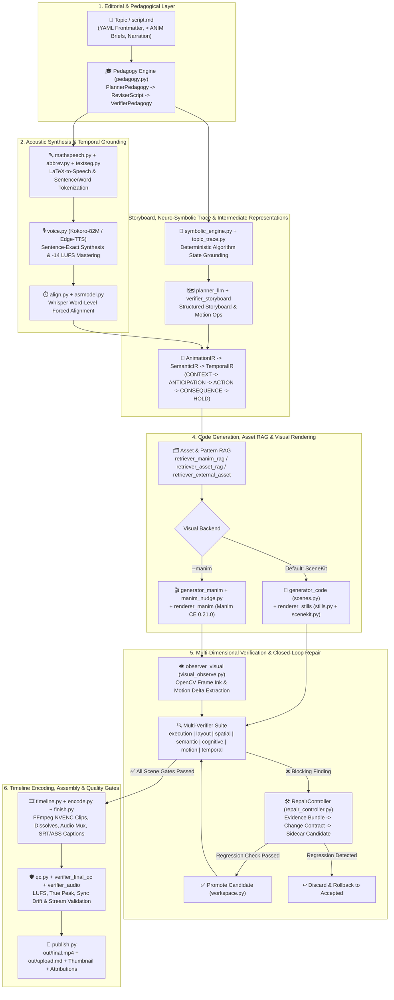
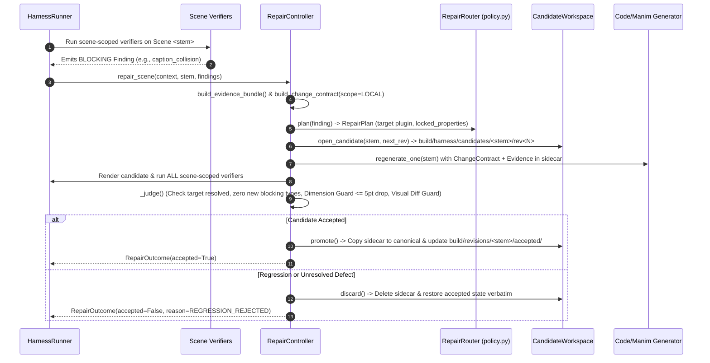

# 🏗️ Prompt2Render — End-to-End Project Architecture & Complete File Reference

> **Prompt2Render** is an industrial, local-first, end-to-end automated educational video synthesis engine. It transforms a topic or markdown script (`script.md`) into a mastered 1080p human-narrated, mathematically animated explainer video (`out/final.mp4`) with millisecond word-level synchronization, deterministic pixel/geometry collision auditing, neuro-symbolic algorithm tracing, multilingual shaping, and an autonomous self-correction & Human-in-the-Loop (HITL) harness.

---

## 📑 Table of Contents

1. [High-Level Architectural Philosophy](#-1-high-level-architectural-philosophy)
2. [End-to-End System Architecture & Data Flow](#-2-end-to-end-system-architecture--data-flow)
   - [Dual Execution Architectures (Direct Pipeline vs. Agentic Harness DAG)](#21-dual-execution-architectures-direct-pipeline-vs-agentic-harness-dag)
   - [End-to-End Pipeline Flowchart](#22-end-to-end-pipeline-flowchart)
   - [Harness Plugin Topological DAG](#23-harness-plugin-topological-dag)
   - [Closed-Loop Self-Correction & Revision Lifecycle](#24-closed-loop-self-correction--revision-lifecycle)
   - [Dual Visual Rendering Engines (SceneKit vs. Manim CE 0.21.0)](#25-dual-visual-rendering-engines-scenekit-vs-manim-ce-0210)
3. [Complete File-by-File Reference Guide](#-3-complete-file-by-file-reference-guide)
   - [3.1 Root Configuration, Entrypoints & DevOps Files](#31-root-configuration-entrypoints--devops-files)
   - [3.2 Core Package (`prompt2render/`)](#32-core-package-prompt2render)
   - [3.3 Visual Assets, Catalog, Providers & Mobjects (`prompt2render/assets/`)](#33-visual-assets-catalog-providers--mobjects-prompt2renderassets)
   - [3.4 Autonomous Self-Correction Harness Core (`prompt2render/harness/`)](#34-autonomous-self-correction-harness-core-prompt2renderharness)
   - [3.5 Harness Pipeline Plugins (`prompt2render/harness/plugins/`)](#35-harness-pipeline-plugins-prompt2renderharnessplugins)
   - [3.6 Multilingual Video Synthesis Engine (`prompt2render/multilingual/`)](#36-multilingual-video-synthesis-engine-prompt2rendermultilingual)
   - [3.7 Local Studio Web Dashboard (`prompt2render/web/`)](#37-local-studio-web-dashboard-prompt2renderweb)
   - [3.8 Evaluation, Ablation & Build Tools (`prompt2render/tools/` & `tools/`)](#38-evaluation-ablation--build-tools-prompt2rendertools--tools)
   - [3.9 Architecture & Design Documentation (`prompt2render/docs/`)](#39-architecture--design-documentation-prompt2renderdocs)
   - [3.10 Automated Test Suites (`prompt2render/tests/` & `tests/`)](#310-automated-test-suites-prompt2rendertests--tests)
   - [3.11 Workspace Projects, Models, Media & Backlog (`projects/`, `models/`, `media/`, `Final Results/`, `topics/`)](#311-workspace-projects-models-media--backlog)

---

## 🧠 1. High-Level Architectural Philosophy

Traditional AI video generators fail at technical and educational content due to three core problems:
1. **Spatial Hallucination & Visual Collisions:** LLMs writing raw animation code have no spatial awareness—they stack labels over equations, place text off-screen, or draw arrows through nodes.
2. **Audio-Visual Desynchronization:** Generating audio and video independently causes timing drift, where visual transitions miss the spoken explanation.
3. **Algorithmic Hallucination:** LLMs frequently invent wrong intermediate array states when animating sorting, searching, or graph algorithms.

**Prompt2Render solves all three deterministically:**
- **Acoustic Authority:** Narration is synthesized sentence-by-sentence via **Kokoro-82M** (`voice.py`), mastered to **-14 LUFS** (EBU R128), and force-aligned at the word level via **Whisper ASR** (`align.py`). Every visual transition is anchored to exact spoken word timestamps.
- **Neuro-Symbolic Grounding:** Before prompting the LLM for algorithm scenes, `symbolic_engine.py` and `topic_trace.py` deterministically execute the algorithm (e.g., Bubble Sort, QuickSort, Binary Search, BST, Euclid GCD) and inject exact step-by-step state snapshots into the prompt.
- **Deterministic Geometry & Pixel Critics:** Both rendering backends (**SceneKit** Matplotlib 2D primitives and **Manim CE 0.21.0**) enforce strict coordinate safe-zones (`layout_zones.py`, `scenekit.py`, `manim_audit.py`, `manim_nudge.py`, `visual_observe.py`). Overlapping bounding boxes or blank frames are caught before final assembly.
- **Artifact-Centric Self-Correction Harness:** A topological plugin DAG (`harness/`) verifies syntax, execution, layout, spatial geometry, motion traces, cognitive load, and temporal sync. When a verifier flags a blocking `Finding`, the `RepairController` constructs an `EvidenceBundle` and a scope-locked `ChangeContract`, renders a candidate in an isolated sidecar directory (`workspace.py`), re-verifies all dimensions, and automatically rolls back if any previously passing dimension regresses.

---

## 🔄 2. End-to-End System Architecture & Data Flow

### 2.1 Dual Execution Architectures (Direct Pipeline vs. Agentic Harness DAG)

Prompt2Render supports two complementary execution paths:
1. **Direct Stage-by-Stage CLI Pipeline (`build` / `auto`):** Calls modular stages sequentially (`voice` → `align` → `scenes` → `stills` → `plan` → `encode` → `finish` → `check`), utilizing mtime/hash disk caching.
2. **Agentic Self-Correcting Harness (`harness` / `auto --harness`):** Resolves a 31-plugin Directed Acyclic Graph (DAG) based on declared dependencies and effects over a shared `SceneContext`, backed by `RepairController`, `EventBus`, `EventJournal`, and candidate workspace isolation.

### 2.2 End-to-End Pipeline Flowchart

### 2.3 Harness Plugin Topological DAG

The harness loader ([`prompt2render/harness/loader.py`](file:///c:/projects/Prompt2Render/prompt2render/harness/loader.py)) orders plugins automatically by inspecting each plugin's `declare_dependencies()` and `declare_effects()`:

```mermaid
flowchart LR
    PS[planner_script] --> CS[chunker_scene]
    CS --> PP[planner_pedagogy]
    PP --> RS[reviser_script]
    RS --> VP[verifier_pedagogy]
    VP --> PLLM[planner_llm]
    VP --> PV[planner_visual]
    PV --> GV[generator_voice]
    GV --> GA[generator_align]
    GA --> PA[planner_audio]
    PLLM --> VS[verifier_storyboard]
    PA --> VS
    VS --> VAIR[verifier_animation_ir]
    VAIR --> PSEM[planner_semantic]
    PSEM --> PTEMP[planner_temporal]
    PTEMP --> RAG[retriever_manim_rag / asset_rag / external_asset]
    RAG --> GC[generator_code / generator_manim]
    GC --> VEX[verifier_execution]
    GC --> VCOG[verifier_cognitive]
    VEX --> REND[renderer_stills / renderer_manim]
    REND --> OBS[observer_visual]
    OBS --> VPOST[verifier_semantic / spatial / layout / motion / lifecycle / temporal]
    VPOST --> HITL[feedback_hitl / verifier_hitl_approval]
    HITL --> TAIL[generator_timeline -> renderer_encode -> renderer_finish / renderer_manim_finish]
    TAIL --> VFIN[verifier_audio -> verifier_final_qc -> generator_publish]
```

### 2.4 Closed-Loop Self-Correction & Revision Lifecycle

### 2.5 Dual Visual Rendering Engines (SceneKit vs. Manim CE 0.21.0)

| Feature | SceneKit Engine (Default) | Manim Engine (`--manim`) |
| :--- | :--- | :--- |
| **Core Library** | Matplotlib + Pillow + NumPy ([`scenekit.py`](file:///c:/projects/Prompt2Render/prompt2render/scenekit.py)) | Manim Community Edition `0.21.0` ([`visuals.py`](file:///c:/projects/Prompt2Render/prompt2render/visuals.py), [`renderer_manim`](file:///c:/projects/Prompt2Render/prompt2render/harness/plugins/renderer_manim/__init__.py)) |
| **Artifact Granularity** | Multi-state high-DPI PNG stills per section (`build/stills/<sec>_<state>.png`) | Continuous 1080p MP4 clip per section (`build/manim/<sec>/scene_<sec>.mp4`) |
| **Choreography & Motion** | Frame-exact FFmpeg cuts & cross-dissolves driven by [`timeline.py`](file:///c:/projects/Prompt2Render/prompt2render/timeline.py) | Vector interpolations (`Create`, `Transform`, `MoveTo`, 3D cameras) + optional deterministic Motion Compiler & Construction DSL |
| **Layout Auditing** | Exact artist bounding-box polygon collision critic in [`scenekit.py`](file:///c:/projects/Prompt2Render/prompt2render/scenekit.py) | AST preflight + [`manim_nudge.py`](file:///c:/projects/Prompt2Render/prompt2render/manim_nudge.py) + [`manim_audit.py`](file:///c:/projects/Prompt2Render/prompt2render/manim_audit.py) + OpenCV pixel/motion observer ([`visual_observe.py`](file:///c:/projects/Prompt2Render/prompt2render/visual_observe.py)) |

---

## 📂 3. Complete File-by-File Reference Guide

Every file in the repository is documented below, grouped by subsystem.

---

### 3.1 Root Configuration, Entrypoints & DevOps Files

| File | Detailed Explanation |
| :--- | :--- |
| [`prompt2render.py`](file:///c:/projects/Prompt2Render/prompt2render.py) | Root CLI entrypoint shim that re-exports all symbols and `main()` from [`prompt2render/cli.py`](file:///c:/projects/Prompt2Render/prompt2render/cli.py) so users can invoke `python prompt2render.py <subcommand>` directly from the repository root. |
| [`sitecustomize.py`](file:///c:/projects/Prompt2Render/sitecustomize.py) | Python startup hook automatically loaded by the Python interpreter in the workspace. Invokes `apply_text_patches()` from [`prompt2render/assets/mobjects/base.py`](file:///c:/projects/Prompt2Render/prompt2render/assets/mobjects/base.py) to patch Manim `Text` kerning and typography defaults across all subprocesses. |
| [`demo_self_correction.py`](file:///c:/projects/Prompt2Render/demo_self_correction.py) | Standalone offline demonstration script that exercises the closed-loop `RepairController` on two scripted scenarios: (1) injecting a caption-overflow defect and repairing it via a `LOCAL` change contract, and (2) injecting a regressive repair candidate that breaks layout score and proving the dimension guard rejects and rolls it back. |
| [`test.py`](file:///c:/projects/Prompt2Render/test.py) | Minimal scratch test script in the root directory used for quick one-off verification of local imports and environment sanity. |
| [`Dockerfile`](file:///c:/projects/Prompt2Render/Dockerfile) | Multi-dependency container image definition based on `python:3.11-slim`. Installs system dependencies (`ffmpeg`, `libcairo2-dev`, `libpango1.0-dev`, `texlive-latex-base`, `texlive-latex-extra`, `dvisvgm`), installs Python requirements, runs `doctor`, and exposes port `8787` for the FastAPI studio dashboard. |
| [`docker-compose.yml`](file:///c:/projects/Prompt2Render/docker-compose.yml) | Docker Compose orchestration file defining two services: `studio` (runs `python prompt2render.py serve --host 0.0.0.0 --port 8787` with mounted `projects/`, `media/`, and `models/` volumes) and `worker` (runs `python prompt2render.py doctor` for CLI batch jobs). |
| [`.dockerignore`](file:///c:/projects/Prompt2Render/.dockerignore) | Excludes local virtual environments, git history, large media artifacts, and caches from the Docker build context. |
| [`.github/workflows/ci.yml`](file:///c:/projects/Prompt2Render/.github/workflows/ci.yml) | GitHub Actions CI pipeline running on `ubuntu-latest` with Python 3.11. Installs Cairo, Pango, FFmpeg, and TeX Live packages, installs `requirements.txt`, runs `python prompt2render.py doctor`, and executes the full `pytest` test suite. |
| [`setup.ps1`](file:///c:/projects/Prompt2Render/setup.ps1) | Native Windows PowerShell bootstrap installer. Installs system tools (`Python 3.12`, `Git`, `FFmpeg`, `MiKTeX`) via `winget`, creates `.venv`, installs pinned dependencies from `requirements.txt`, downloads Whisper/VAD/Kokoro weights, and runs `doctor`. |
| [`setup.sh`](file:///c:/projects/Prompt2Render/setup.sh) | Cross-platform POSIX (`bash`) installer for Linux (`apt`/`dnf`/`pacman`) and macOS (`brew`). Installs system libraries, creates `.venv`, installs Python packages, fetches local ML models, and runs health checks. |
| [`requirements.txt`](file:///c:/projects/Prompt2Render/requirements.txt) | Pinned top-level Python dependencies (`manim==0.21.0`, `kokoro-onnx`, `soundfile`, `matplotlib`, `Pillow`, `opencv-python`, `fastapi`, `uvicorn`, `edge-tts`, `pytest`, `sympy`, `networkx`, `PyYAML`, etc.). |
| [`requirements.lock`](file:///c:/projects/Prompt2Render/requirements.lock) | Fully frozen transitive dependency lockfile generated by `pip freeze` for deterministic environment reproduction. |
| [`pytest.ini`](file:///c:/projects/Prompt2Render/pytest.ini) | Pytest configuration file defining test discovery paths (`prompt2render/tests`) and warning filters. |
| [`.env.example`](file:///c:/projects/Prompt2Render/.env.example) | Template environment configuration documenting `GEMINI_API_KEY`, backup keys (`GEMINI_API_KEY_BACKUP1..5`), per-role model overrides (`P2R_SCENE_MODEL`, `P2R_PLANNER_MODEL`, etc.), and voice/render concurrency flags. |
| [`.gitignore`](file:///c:/projects/Prompt2Render/.gitignore) | Git ignore rules excluding `.env`, `.venv`, `__pycache__`, downloaded model binaries, and heavy intermediate project build directories. |
| [`README.md`](file:///c:/projects/Prompt2Render/README.md) | Main project documentation covering system architecture, visual showcase, installation instructions, CLI command reference, and benchmark metrics. |
| [`HITL_WORKFLOW.md`](file:///c:/projects/Prompt2Render/HITL_WORKFLOW.md) | Step-by-step user guide explaining how to create `projects/<slug>/hitl_feedback.json` with `"accept"` or `"reject"` statuses to trigger selective Human-in-the-Loop scene repairs. |
| [`project_cmds.md`](file:///c:/projects/Prompt2Render/project_cmds.md) | Quick reference cheat-sheet of common CLI commands for scaffolding, drafting, building, and inspecting projects. |

---

### 3.2 Core Package (`prompt2render/`)

| File | Detailed Explanation |
| :--- | :--- |
| [`prompt2render/__init__.py`](file:///c:/projects/Prompt2Render/prompt2render/__init__.py) | Package initializer exposing package metadata and top-level version conventions. |
| [`prompt2render/__main__.py`](file:///c:/projects/Prompt2Render/prompt2render/__main__.py) | Module execution entrypoint enabling `python -m prompt2render <command>` by delegating to `prompt2render.cli.main()`. |
| [`prompt2render/prompt2render.py`](file:///c:/projects/Prompt2Render/prompt2render/prompt2render.py) | Internal backward-compatibility shim that re-exports `prompt2render.cli` functions for legacy callers and tests importing `prompt2render.prompt2render`. |
| [`prompt2render/cli.py`](file:///c:/projects/Prompt2Render/prompt2render/cli.py) | **Authoritative CLI Orchestrator (1,658 LOC).** Implements all subcommands: `new`, `draft`, `doctor`, `models`, `voices`, `languages`, `multilingual`, `serve`, `voice`, `align`, `scenes`, `stills`, `plan`, `encode`, `finish`, `check`, `build`, `auto`, `harness`, `ablation`, `events`, `scene-history`, `revisions`, `verify`, `repair`, `rollback`, `replay`, `harness-check`, `report`, `import`, `placeholders`, `manim`, `assemble`, `publish`, and `animate`. Handles argument parsing, config overrides, `--manim` toggling, and HITL mode flags. |
| [`prompt2render/cfg.py`](file:///c:/projects/Prompt2Render/prompt2render/cfg.py) | **Global Configuration & System Probe.** Manages workspace paths (`ROOT`, `PROJECTS`, `MODELS`), `.env` loading, video dimensions (`1920x1080` 16:9 or `1080x1920` 9:16 via `set_dimensions()`), frame rate (`FPS = 30`), audio targets (`-14 LUFS`, `48000 Hz`), FFmpeg/FFprobe binary discovery, NVENC hardware encoder detection, and subprocess wrappers (`sh()`, `duration()`, `slugify()`). |
| [`prompt2render/project.py`](file:///c:/projects/Prompt2Render/prompt2render/project.py) | **Project Workspace & `script.md` Parser.** Defines the `Script` and `Section` dataclasses. Parses `script.md` files (extracting YAML-like frontmatter metadata, `## NN — Title` headers, `> ANIM:` visual briefs, `> SOURCE:` media directives, and spoken narration paragraphs) and scaffolds new project folder structures (`audio/`, `scenes/`, `sections/`, `build/`, `out/`). |
| [`prompt2render/outline.py`](file:///c:/projects/Prompt2Render/prompt2render/outline.py) | **AI Topic Outliner.** Prompts the LLM (`llm.complete`) to decompose a user's topic seed into a structured multi-section curriculum with section titles, pedagogical goals, concrete examples, and initial `> ANIM:` visual briefs tailored to the target duration (`--minutes`). |
| [`prompt2render/draft.py`](file:///c:/projects/Prompt2Render/prompt2render/draft.py) | **AI Narration Writer.** Fills unwritten `[write narration here]` placeholders in `script.md` using Gemini while enforcing spoken-style constraints (no markdown lists in narration, concrete numbers synced with the `> ANIM:` brief, natural sentence lengths for TTS). |
| [`prompt2render/pedagogy.py`](file:///c:/projects/Prompt2Render/prompt2render/pedagogy.py) | **Pedagogical Critique & Script Revision Engine.** Evaluates `script.md` both deterministically (checking word counts, concrete examples, placeholder remnants, and brief-to-narration alignment) and via an LLM Editor rubric (audience fit, prerequisites, cognitive load). Produces structured `PedagogyReview` objects and powers automated script rewrites before voice synthesis. |
| [`prompt2render/llm.py`](file:///c:/projects/Prompt2Render/prompt2render/llm.py) | **Resilient Multi-Model & Multi-Key LLM Client.** Interfaces with Google Gemini (`generateContent` REST API) and OpenAI-compatible endpoints. Implements automatic API key rotation (`GEMINI_API_KEY`, `GEMINI_API_KEY_BACKUP*`), monotonic model fallback chains, permanent `NOT_FOUND` (404) model skipping, rate-limit (429) exponential backoff, and telemetry recording (`FALLBACK_RECORDS`) for provenance. |
| [`prompt2render/abbrev.py`](file:///c:/projects/Prompt2Render/prompt2render/abbrev.py) | **Unified Abbreviation Expansion Table.** Single source of truth mapping abbreviations (`i.e.`, `e.g.`, `vs.`, `km`, `GHz`, `GB`, `RAM`, titles) to their spoken forms. Shared by both `mathspeech.py` (for TTS synthesis) and `textseg.py` (for Whisper alignment & caption-drift verification) so TTS pronunciation and ASR expectations never diverge. |
| [`prompt2render/mathspeech.py`](file:///c:/projects/Prompt2Render/prompt2render/mathspeech.py) | **Math & LaTeX-to-Speech Verbalizer.** Converts inline mathematical expressions (`$O(n \log n)$`, `$x^2 + y^2 = z^2$`, `\frac{a}{b}`, subscripts, Greek letters, operators) and technical identifiers (`snake_case`, `camelCase`, acronyms) into natural spoken English strings for Kokoro TTS while preserving the original LaTeX notation for on-screen captions. |
| [`prompt2render/textseg.py`](file:///c:/projects/Prompt2Render/prompt2render/textseg.py) | **Linguistic Sentence & Word Tokenizer.** Splits narration into synthesis-ready sentences (`split_sentences`) without breaking on abbreviations or decimal numbers, and normalizes word tokens (`normalise_token`) for phonetic Levenshtein alignment between script text and Whisper ASR output. |
| [`prompt2render/voice.py`](file:///c:/projects/Prompt2Render/prompt2render/voice.py) | **Neural TTS Synthesis & EBU R128 Audio Mastering.** Synthesizes narration sentence-by-sentence using local **Kokoro-82M ONNX** (or Edge-TTS / pre-recorded `own` audio), supports multi-speaker `[voice: name]` tags, inserts exact inter-sentence silence buffers, writes `.sent.json` sentence boundary manifests, and masters loudness across the entire programme to **-14 LUFS** with a `-1.5 dBTP` true-peak limiter. |
| [`prompt2render/asrmodel.py`](file:///c:/projects/Prompt2Render/prompt2render/asrmodel.py) | **ASR & VAD Model Manager.** Downloads, verifies SHA-256 checksums, and caches local Whisper `ggml` model weights (`ggml-base.en.bin`) and Silero VAD weights inside `models/whisper/`. |
| [`prompt2render/align.py`](file:///c:/projects/Prompt2Render/prompt2render/align.py) | **Whisper Forced-Alignment & Boundary Reconciler.** Runs Whisper ASR (via FFmpeg's `whisper` filter or local weights) on synthesized section audio (`audio/<sec>.m4a`), aligns recognized words against script words via dynamic programming, and reconciles word timestamps within exact `.sent.json` sentence boundaries so timing drift cannot accumulate across sentences. Writes `audio/<sec>.align.json`. |
| [`prompt2render/audio_foley.py`](file:///c:/projects/Prompt2Render/prompt2render/audio_foley.py) | **Procedural Acoustic Sound Effects (Foley) Synthesizer.** Zero-dependency pure-math waveform generator creating 48kHz PCM WAV sound effects (`make_whoosh`, `make_pop`, `make_chime`, `make_click`) with Hann window envelopes, and mixing them at exact animation cue timestamps into section audio tracks. |
| [`prompt2render/symbolic_engine.py`](file:///c:/projects/Prompt2Render/prompt2render/symbolic_engine.py) | **Neuro-Symbolic Invariant Engine.** Provides deterministic step-by-step algorithm tracers (`trace_sorting` for bubble/insertion/selection/merge/quick/heap sort, `trace_binary_search`, `trace_bst_insertion`, `trace_euclid_gcd`), symbolic calculus/algebra solvers via `sympy`, and collision-free graph/tree node layout coordinate solvers via `networkx`. |
| [`prompt2render/topic_trace.py`](file:///c:/projects/Prompt2Render/prompt2render/topic_trace.py) | **Topic-Aware Ground-Truth Prompt Injector.** Inspects a section's `> ANIM:` brief and narration, detects algorithmic topics via regex patterns, extracts literal input arrays/targets from the text, runs the corresponding tracer in `symbolic_engine.py`, and formats the exact state sequence as a ground-truth prompt block for the code generator. |
| [`prompt2render/topic_router.py`](file:///c:/projects/Prompt2Render/prompt2render/topic_router.py) | **Semantic Renderer Router.** Analyzes section briefs to classify whether a topic requires continuous kinetic motion (e.g., sorting swaps, signal propagation, 3D loss surfaces → routes to **Manim**) or deterministic structural diagrams (e.g., memory tables, architecture blocks → routes to **SceneKit/Matplotlib**). |
| [`prompt2render/cognitive_signaling.py`](file:///c:/projects/Prompt2Render/prompt2render/cognitive_signaling.py) | **Mayer-Sweller Cognitive Load & Attention Optimizer.** Extracts salient technical concepts from narration, computes pre-attentive visual signaling schedules (`-150ms` lead time before a term is spoken), detects split-attention lag, and checks on-screen text for phonological redundancy (preventing slides that copy full spoken paragraphs verbatim). |
| [`prompt2render/scenes.py`](file:///c:/projects/Prompt2Render/prompt2render/scenes.py) | **LLM Storyboarder, Code Generator & Static AST Validator.** Prompts Gemini to generate `build/scenes/sec_<NN>.py` modules against SceneKit or Manim APIs. Contains comprehensive static AST validators (`validate_scene_source` and `validate_manim_source`) that inspect Python ASTs prior to execution for syntax errors, forbidden imports, backend mixing, invalid Manim kwargs (via runtime `inspect.signature` against installed Manim classes), hallucinated `MathTex` methods, and unescaped LaTeX characters. |
| [`prompt2render/scenekit.py`](file:///c:/projects/Prompt2Render/prompt2render/scenekit.py) | **SceneKit 2D Vector Drawing Engine & Pixel Geometry Layout Critic.** Provides high-level declarative drawing primitives on a 16:9 coordinate grid (`Canvas`, `box`, `array`, `stack`, `tree`, `graph`, `panel`, `code`, `table`, `axes`, `arrow`, `brace`, `badge`, `caption`) and implements `audit()`, which inspects rendered artist bounding boxes in pixel space for text overlaps, arrow-through-label collisions, out-of-bounds clipping, and empty frames. |
| [`prompt2render/stills.py`](file:///c:/projects/Prompt2Render/prompt2render/stills.py) | **SceneKit Still Rasterizer.** Executes generated `sec_<NN>.py` modules in isolated worker processes, renders each visual state (`s00`, `s01`, ...) to high-DPI PNG files under `build/stills/`, runs `scenekit.audit()` on every frame, and writes `build/stills/sec_<NN>.manifest.json`. |
| [`prompt2render/manimver.py`](file:///c:/projects/Prompt2Render/prompt2render/manimver.py) | **Manim Version Guard.** Enforces the pinned Manim Community Edition target version (`0.21.0` by default, or overridden via `P2R_MANIM_VERSION`), probing the active Python environment and reporting version mismatches cleanly. |
| [`prompt2render/manim_smoke.py`](file:///c:/projects/Prompt2Render/prompt2render/manim_smoke.py) | **Deterministic Manim Smoke Probe.** Contains `P2RSmokeScene` (testing `Text`, `Rectangle`, `VGroup`, `MathTex`, `Arrow`, and `Code` mobjects) shared by `prompt2render doctor --render-test` and the test suite to verify that Manim, Cairo, Pango, LaTeX (`dvisvgm`), and FFmpeg can render a valid 1920x1080@30fps MP4 clip. |
| [`prompt2render/manim_nudge.py`](file:///c:/projects/Prompt2Render/prompt2render/manim_nudge.py) | **Source-Level Manim Geometry Healer.** Deterministically rewrites generated Manim Python source code before rendering to fix common LLM layout bugs: (1) chaining sibling `.next_to(parent, DOWN)` calls so labels don't stack on top of each other, (2) shifting crowded `.move_to()` calls sharing identical Y coordinates, and (3) clamping non-caption elements that trespass into the bottom caption safe zone (`y < -2.4`). |
| [`prompt2render/manim_audit.py`](file:///c:/projects/Prompt2Render/prompt2render/manim_audit.py) | **Runtime Manim Bounding-Box Auditor.** Implements `ManimLayoutAuditor`, computing Axis-Aligned Bounding Box (AABB) Intersection-over-Union (IoU) collisions, frame margin overflows, and caption safe-zone violations across instantiated Manim `Mobject` trees and rendered PNG frames. |
| [`prompt2render/cinematic.py`](file:///c:/projects/Prompt2Render/prompt2render/cinematic.py) | **Cinematic Camera & Polish Engine for Manim.** Provides 3Blue1Brown/Kurzgesagt-style visual helpers for Manim scenes: camera auto-framing (`camera_focus_on`), ambient background grids, glowing highlights (`glow_surround`), smooth elastic rate functions, and animated callout pointers. |
| [`prompt2render/timing_corrector.py`](file:///c:/projects/Prompt2Render/prompt2render/timing_corrector.py) | **Analytical Manim Timing Normalizer.** Post-processes LLM-generated Manim code by parsing `# cue: <idx>` comments, `self.play(..., run_time=...)`, and `self.wait(...)` calls, scaling durations analytically so each visual beat matches its Whisper-aligned sentence window and total audio duration to the millisecond. |
| [`prompt2render/visuals.py`](file:///c:/projects/Prompt2Render/prompt2render/visuals.py) | **Manim Subprocess Runner & Frame Extractor.** Invokes the `manim` CLI with configured resolution/fps flags, manages temporary media directories, extracts representative preview stills via FFmpeg (`extract_preview_png`), and handles subprocess timeouts and error log capture. |
| [`prompt2render/visual_observe.py`](file:///c:/projects/Prompt2Render/prompt2render/visual_observe.py) | **OpenCV Visual Grounding & Motion Trace Observer.** Samples rendered video clips at state timestamps using FFmpeg + OpenCV (`cv2`), computing `ink_fraction` (non-background pixel coverage to detect blank/off-screen scenes) and `frame_delta` (inter-frame pixel differencing across a state's `run_time` window to verify that scheduled motion actually occurred on screen). |
| [`prompt2render/video_conform.py`](file:///c:/projects/Prompt2Render/prompt2render/video_conform.py) | **Real-World B-Roll & Hybrid Media Conformer.** Resolves external live-action or stock video clips (`assets/videos/`), and conforms them via FFmpeg (scaling/padding to 1920x1080@30fps, looping or trimming to match exact section narration duration, and applying color grading) for hybrid documentary-style videos. |
| [`prompt2render/timeline.py`](file:///c:/projects/Prompt2Render/prompt2render/timeline.py) | **Frame-Exact Cut Planner.** Combines `build/stills/sec_<NN>.manifest.json` cues with `audio/<NN>.align.json` word timestamps. Applies pre-roll lead offset (`lead_ms = 120ms` so visuals appear slightly before the keyword is uttered), snaps every cut to an exact integer frame boundary at 30fps, and writes `build/plan.json`. |
| [`prompt2render/encode.py`](file:///c:/projects/Prompt2Render/prompt2render/encode.py) | **Parallel Hardware-Accelerated Clip Encoder.** Reads `build/plan.json` and encodes one MP4 segment per still transition in parallel worker processes (`--jobs`), rendering smooth cross-dissolve transitions at the head of each state clip using FFmpeg (`h264_nvenc` or `libx264`). |
| [`prompt2render/captions.py`](file:///c:/projects/Prompt2Render/prompt2render/captions.py) | **Subtitle & Caption Generator.** Segments aligned word timestamps into readable subtitle cards (respecting max characters per line and sentence boundaries) and writes both YouTube-ready SubRip (`out/captions.srt`) and styled Advanced SubStation Alpha (`build/captions.ass`) subtitle files. |
| [`prompt2render/finish.py`](file:///c:/projects/Prompt2Render/prompt2render/finish.py) | **Master Video Assembler (`finish` & `finish_manim`).** Concatenates per-section video clips, verifies master audio sync, muxes the `-14 LUFS` 48kHz AAC audio track, injects FFmpeg chapter markers for each section, optionally burns in subtitles, and outputs `out/final.mp4` and `out/thumb_source.png`. |
| [`prompt2render/assemble.py`](file:///c:/projects/Prompt2Render/prompt2render/assemble.py) | **Legacy Clip Assembler.** Conservative fallback assembly module for projects with externally rendered section clips (`sections/<NN>.mp4`) without cue-level still manifests; pads short visuals by holding the final frame and never speed-ramps narration. |
| [`prompt2render/qc.py`](file:///c:/projects/Prompt2Render/prompt2render/qc.py) | **Production Quality Control Gates.** Inspects `out/final.mp4` and intermediate artifacts to verify: (1) H.264/AAC codec compliance, (2) 1920x1080@30fps geometry, (3) audio-video duration delta within tolerance, (4) EBU R128 integrated loudness (`-14 LUFS`) and true peak (`<= -1.0 dBTP`), (5) zero dead-air silences > 1.5s, (6) Whisper ASR re-transcription caption sync drift (`caption_drift`), and (7) zero layout audit collisions. Writes `out/qc.json`. |
| [`prompt2render/publish.py`](file:///c:/projects/Prompt2Render/prompt2render/publish.py) | **Release Packet & Attribution Builder.** Generates `out/upload.md` (YouTube title, SEO description, timestamped chapter list, tags), composites the master thumbnail (`out/thumbnail_master.png`), and compiles `out/attributions.md` listing licenses for any external stock/SVG assets used. |
| [`prompt2render/doctor.py`](file:///c:/projects/Prompt2Render/prompt2render/doctor.py) | **Environment & Toolchain Diagnostic Probe.** Checks Python version, FFmpeg/FFprobe binaries, Whisper filter support, NVENC GPU availability, LaTeX (`pdflatex`/`xelatex`/`dvisvgm`), Manim version (`0.21.0`), local ASR/VAD/Kokoro model files, and Gemini API keys. Supports `--render-test` to execute `manim_smoke.py`. |

---

### 3.3 Visual Assets, Catalog, Providers & Mobjects (`prompt2render/assets/`)

| File | Detailed Explanation |
| :--- | :--- |
| [`prompt2render/assets/__init__.py`](file:///c:/projects/Prompt2Render/prompt2render/assets/__init__.py) | Exports core asset management symbols (`AssetCache`, `AssetDefinition`, `load_catalog`, `prepare_scene_asset`, `is_asset_relevant`, `detect_domain`). |
| [`prompt2render/assets/loader.py`](file:///c:/projects/Prompt2Render/prompt2render/assets/loader.py) | Defines `AssetDefinition` and loads/validates all sharded JSON category manifests under `prompt2render/assets/catalog/`. |
| [`prompt2render/assets/embeddings.py`](file:///c:/projects/Prompt2Render/prompt2render/assets/embeddings.py) | Implements `SparseSemanticVectorizer`, a deterministic zero-dependency TF-IDF cosine-similarity search engine over the asset catalog for fast local asset RAG retrieval. |
| [`prompt2render/assets/relevance.py`](file:///c:/projects/Prompt2Render/prompt2render/assets/relevance.py) | Domain classifier (`detect_domain`) and cross-domain contamination filter (`is_asset_relevant`) that prevents irrelevant external stock media (e.g., computer server photos in a medical cardiology video) from passing retrieval gates. |
| [`prompt2render/assets/cache.py`](file:///c:/projects/Prompt2Render/prompt2render/assets/cache.py) | Content-addressed local disk cache (`AssetCache`) for downloaded external images, videos, and SVGs, tracking source URLs, authors, and license metadata for automatic attribution generation. |
| [`prompt2render/assets/preprocessor.py`](file:///c:/projects/Prompt2Render/prompt2render/assets/preprocessor.py) | Normalizes, sanitizes, and scales SVG/PNG/Lottie assets before they are imported into Manim or SceneKit scenes. |
| **Asset Format Adapters (`prompt2render/assets/adapters/`)** | |
| [`prompt2render/assets/adapters/__init__.py`](file:///c:/projects/Prompt2Render/prompt2render/assets/adapters/__init__.py) | Exports format adapters (`BaseAssetAdapter`, `SVGAssetAdapter`, `LottieAssetAdapter`, `RiveAssetAdapter`). |
| [`prompt2render/assets/adapters/base.py`](file:///c:/projects/Prompt2Render/prompt2render/assets/adapters/base.py) | Abstract base interface for multi-format visual asset adapters. |
| [`prompt2render/assets/adapters/svg_adapter.py`](file:///c:/projects/Prompt2Render/prompt2render/assets/adapters/svg_adapter.py) | Validates XML/SVG structure, strips unsafe tags (`<script>`, `<foreignObject>`), normalizes viewBoxes, and converts SVG assets into Manim `SVGMobject` or SceneKit primitives. |
| [`prompt2render/assets/adapters/lottie_adapter.py`](file:///c:/projects/Prompt2Render/prompt2render/assets/adapters/lottie_adapter.py) | Parses Lottie JSON keyframe animations (`assets/lottie/`), extracting layer transforms and interpolating frame states for Manim/SceneKit rendering. |
| [`prompt2render/assets/adapters/rive_adapter.py`](file:///c:/projects/Prompt2Render/prompt2render/assets/adapters/rive_adapter.py) | Adapter interface for stateful `.riv` Rive animation state machines. |
| **External Media Providers (`prompt2render/assets/providers/`)** | |
| [`prompt2render/assets/providers/__init__.py`](file:///c:/projects/Prompt2Render/prompt2render/assets/providers/__init__.py) | Exports external stock media providers (`AssetHit`, `AssetProvider`, `PexelsProvider`, `PixabayProvider`, `UnsplashProvider`, `MockAssetProvider`). |
| [`prompt2render/assets/providers/base.py`](file:///c:/projects/Prompt2Render/prompt2render/assets/providers/base.py) | Defines `AssetHit` metadata dataclass and the abstract `AssetProvider` search/download interface. |
| [`prompt2render/assets/providers/pexels.py`](file:///c:/projects/Prompt2Render/prompt2render/assets/providers/pexels.py) | REST client for Pexels photo and B-roll video search API (`PEXELS_API_KEY`). |
| [`prompt2render/assets/providers/pixabay.py`](file:///c:/projects/Prompt2Render/prompt2render/assets/providers/pixabay.py) | REST client for Pixabay illustrations, vectors, photos, and videos (`PIXABAY_API_KEY`). |
| [`prompt2render/assets/providers/unsplash.py`](file:///c:/projects/Prompt2Render/prompt2render/assets/providers/unsplash.py) | REST client for high-resolution Unsplash photography (`UNSPLASH_ACCESS_KEY`). |
| [`prompt2render/assets/providers/mock.py`](file:///c:/projects/Prompt2Render/prompt2render/assets/providers/mock.py) | Deterministic offline mock provider used in unit tests and CI without network calls. |
| **Reusable Manim Mobject Component Library (`prompt2render/assets/mobjects/`)** | |
| [`prompt2render/assets/mobjects/__init__.py`](file:///c:/projects/Prompt2Render/prompt2render/assets/mobjects/__init__.py) | Exports all custom Manim Mobject widgets and universal layout stages. |
| [`prompt2render/assets/mobjects/base.py`](file:///c:/projects/Prompt2Render/prompt2render/assets/mobjects/base.py) | Defines `P2RText` and `P2RSVGMobject` with automatic safe-scaling, font fallback resolution, and `apply_text_patches()` to prevent Pango kerning overlaps in Manim. |
| [`prompt2render/assets/mobjects/stages.py`](file:///c:/projects/Prompt2Render/prompt2render/assets/mobjects/stages.py) | **Universal Layout Stage Managers:** `FlowStage`, `SplitStage`, `HeroFocusStage`, `BenchmarkStage`, `AutoVStack`, `AutoHStack`, `SafeCaptionZone`, `CaptionDock`, `AnnotatedCard`, and `MediaCard`. Enforces collision-free zone layout in Manim scenes. |
| [`prompt2render/assets/mobjects/algorithm_widgets.py`](file:///c:/projects/Prompt2Render/prompt2render/assets/mobjects/algorithm_widgets.py) | High-level Manim widgets for algorithm visualization (pointer arrows, comparison brackets, step counters, status banners). |
| [`prompt2render/assets/mobjects/algo_math_widgets.py`](file:///c:/projects/Prompt2Render/prompt2render/assets/mobjects/algo_math_widgets.py) | Defines `ArrayGrid` (indexed array cells with highlight/swap animations), `FormulaCard` (framed LaTeX container), and `KeyBadge`. |
| [`prompt2render/assets/mobjects/data_structures.py`](file:///c:/projects/Prompt2Render/prompt2render/assets/mobjects/data_structures.py) | Defines `BinaryTreeMobject` and linked-node structures with automatic parent-child edge routing. |
| [`prompt2render/assets/mobjects/hardware.py`](file:///c:/projects/Prompt2Render/prompt2render/assets/mobjects/hardware.py) | Defines `MemoryBankMobject` for visualizing RAM addresses, cache lines, registers, and page tables. |
| [`prompt2render/assets/mobjects/math_widgets.py`](file:///c:/projects/Prompt2Render/prompt2render/assets/mobjects/math_widgets.py) | Defines `CoordinateGridMobject` for function plotting, tangent lines, and vector transformations. |
| [`prompt2render/assets/mobjects/network_widgets.py`](file:///c:/projects/Prompt2Render/prompt2render/assets/mobjects/network_widgets.py) | Defines `ServerNode`, `ClientCluster`, `DatabaseNode`, `ConfigCodeCard`, and `MetricBadge` for systems/networking architecture animations. |
| [`prompt2render/assets/mobjects/neural_3d.py`](file:///c:/projects/Prompt2Render/prompt2render/assets/mobjects/neural_3d.py) | 3D neural network layer, synapse pulse, and 3D loss surface Mobjects for `ThreeDScene` animations. |
| **Asset Catalog & Vector Files (`catalog/`, `svg/`, `lottie/`)** | |
| [`prompt2render/assets/catalog/index.json`](file:///c:/projects/Prompt2Render/prompt2render/assets/catalog/index.json) | Root index pointing to the sharded domain catalog JSON files (`biology.json`, `data_structures.json`, `hardware.json`, `math.json`, `networking.json`). |
| `prompt2render/assets/catalog/*.json` | Sharded catalog manifests ([`biology.json`](file:///c:/projects/Prompt2Render/prompt2render/assets/catalog/biology.json), [`data_structures.json`](file:///c:/projects/Prompt2Render/prompt2render/assets/catalog/data_structures.json), [`hardware.json`](file:///c:/projects/Prompt2Render/prompt2render/assets/catalog/hardware.json), [`math.json`](file:///c:/projects/Prompt2Render/prompt2render/assets/catalog/math.json), [`networking.json`](file:///c:/projects/Prompt2Render/prompt2render/assets/catalog/networking.json)) defining schemas, bounds, and keywords for built-in vector and widget assets. |
| `prompt2render/assets/svg/*.svg` | Curated domain SVG vector assets: [`alu_unit.svg`](file:///c:/projects/Prompt2Render/prompt2render/assets/svg/alu_unit.svg), [`bus_line.svg`](file:///c:/projects/Prompt2Render/prompt2render/assets/svg/bus_line.svg), [`cardiac_conduction.svg`](file:///c:/projects/Prompt2Render/prompt2render/assets/svg/cardiac_conduction.svg), [`coronary_artery.svg`](file:///c:/projects/Prompt2Render/prompt2render/assets/svg/coronary_artery.svg), [`hardware_cpu.svg`](file:///c:/projects/Prompt2Render/prompt2render/assets/svg/hardware_cpu.svg), [`heart_anatomy.svg`](file:///c:/projects/Prompt2Render/prompt2render/assets/svg/heart_anatomy.svg), [`register_file.svg`](file:///c:/projects/Prompt2Render/prompt2render/assets/svg/register_file.svg), [`storage_db.svg`](file:///c:/projects/Prompt2Render/prompt2render/assets/svg/storage_db.svg), [`thrombus_occlusion.svg`](file:///c:/projects/Prompt2Render/prompt2render/assets/svg/thrombus_occlusion.svg). |
| `prompt2render/assets/lottie/*.json` | Curated Lottie vector animations: [`packet_stream.json`](file:///c:/projects/Prompt2Render/prompt2render/assets/lottie/packet_stream.json) and [`server_rack_pulse.json`](file:///c:/projects/Prompt2Render/prompt2render/assets/lottie/server_rack_pulse.json) (mirrored in `assets/svg/lottie/`). |

---

### 3.4 Autonomous Self-Correction Harness Core (`prompt2render/harness/`)

| File | Detailed Explanation |
| :--- | :--- |
| [`prompt2render/harness/__init__.py`](file:///c:/projects/Prompt2Render/prompt2render/harness/__init__.py) | Exports core harness types (`SceneContext`, `Plugin`, `HarnessRunner`, `RepairController`, `Finding`, etc.). |
| [`prompt2render/harness/config.yaml`](file:///c:/projects/Prompt2Render/prompt2render/harness/config.yaml) | Declarative YAML configuration controlling `enabled`, `gate_override`, and plugin-specific parameters for all 31 harness plugins, plus repair budgets (`max_repairs_per_scene: 3`, `max_total_repairs: 12`). |
| [`prompt2render/harness/plugin.py`](file:///c:/projects/Prompt2Render/prompt2render/harness/plugin.py) | Defines the abstract `Plugin` base class (`declare_dependencies()`, `declare_effects()`, `is_gate()`, `run(ctx)`). |
| [`prompt2render/harness/context.py`](file:///c:/projects/Prompt2Render/prompt2render/harness/context.py) | Defines `SceneContext`—the single mutable state object passed through the harness DAG—along with typed artifact records (`CodeArtifact`, `RenderArtifact`, `AudioArtifact`, `VideoArtifact`, `HistoryEntry`). |
| [`prompt2render/harness/loader.py`](file:///c:/projects/Prompt2Render/prompt2render/harness/loader.py) | Topological DAG resolver (`resolve_order`, `build_plugins`, `build_repair_controller`). Verifies single-producer invariants (except `MERGEABLE_EFFECTS = {"check_results"}`), detects dependency cycles or missing producers, and wires the `RepairController`. |
| [`prompt2render/harness/runner.py`](file:///c:/projects/Prompt2Render/prompt2render/harness/runner.py) | **Main Harness Execution Engine (`HarnessRunner`).** Executes plugins in topological order, detects scene-plan fingerprint changes to invalidate stale downstream artifacts, intercepts blocking findings, delegates scene repairs to `RepairController`, rewinds the pipeline when repairs update upstream state, and enforces the final-video reachability gate (`_check_final_video_reachable`). |
| [`prompt2render/harness/repair_controller.py`](file:///c:/projects/Prompt2Render/prompt2render/harness/repair_controller.py) | **Single Owner of the Self-Correction Loop (`RepairController`).** Implements `repair_scene()`: builds the `EvidenceBundle` and `ChangeContract`, opens a sidecar candidate workspace, invokes the target generator via `RepairRouter`, renders the candidate, re-runs all scene-scoped verifiers, applies the 8-part `_judge()` acceptance & regression guard, and either promotes or discards the candidate. |
| [`prompt2render/harness/workspace.py`](file:///c:/projects/Prompt2Render/prompt2render/harness/workspace.py) | **Candidate Sidecar Isolation (`CandidateWorkspace`).** Allocates isolated scratch directories (`build/harness/candidates/<stem>/rev<N>/`) so candidate regenerations and renders never overwrite the last accepted scene artifacts until `promote()` is explicitly called. |
| [`prompt2render/harness/evidence.py`](file:///c:/projects/Prompt2Render/prompt2render/harness/evidence.py) | **Diagnostic Evidence & Change Contract Builder.** Normalizes verifier outputs into `evidence.json` (`build_evidence_bundle`), classifies repair scope (`LOCAL` vs `REGIONAL` vs `SCENE`), determines locked passing properties, and builds machine-readable `ChangeContract` objects (`repair.json`) injected into repair prompts. |
| [`prompt2render/harness/finding.py`](file:///c:/projects/Prompt2Render/prompt2render/harness/finding.py) | **Normalized Error Taxonomy.** Defines `Finding`, `FindingCategory` (`SPATIAL`, `TEMPORAL`, `SEMANTIC`, `AUDIO`, `EXECUTION`, `PEDAGOGICAL`), `FindingSeverity` (`BLOCKING`, `WARNING`, `INFO`), `LayoutSubtype`, and `verification_unavailable()` helpers. |
| [`prompt2render/harness/scene_quality.py`](file:///c:/projects/Prompt2Render/prompt2render/harness/scene_quality.py) | **Lexicographic Quality Instrument (`SceneQuality`).** Computes per-scene quality scores across dimensions (`syntax`, `execution`, `layout`, `visual`, `semantic`, `temporal`) and implements `compare(before, after)` + the `DIMENSION_REGRESSION_TOLERANCE` (5-point max drop on clean dimensions) guard. |
| [`prompt2render/harness/visual_state.py`](file:///c:/projects/Prompt2Render/prompt2render/harness/visual_state.py) | **Structured Visual Memory & Diff Guard.** Extracts per-revision visual state snapshots (`visual_state.json`: state counts, ink fractions, bounding boxes, warnings) and computes `visual_diff(before, after)` to reject `LOCAL` repairs that cause unintended structural visual churn. |
| [`prompt2render/harness/convergence.py`](file:///c:/projects/Prompt2Render/prompt2render/harness/convergence.py) | **Repair Convergence & Oscillation Detector.** Tracks finding fingerprints across repair attempts to halt loops early upon detecting zero progress (`NO_PROGRESS`) or `A → B → A` state oscillation (`OSCILLATION_DETECTED`). |
| [`prompt2render/harness/animation_ir.py`](file:///c:/projects/Prompt2Render/prompt2render/harness/animation_ir.py) | **Renderer-Neutral Animation IR (`AnimationIR`).** Typed, versioned, SHA-256-hashed intermediate representation of sections, states, cues, visual descriptions, and motion operations converted from `storyboard_plan`. |
| [`prompt2render/harness/semantic_plan.py`](file:///c:/projects/Prompt2Render/prompt2render/harness/semantic_plan.py) | **5-Stage Pedagogical Beat Model (`SemanticIR`).** Organizes each state's motion operations into the 5-stage pedagogical choreography sequence: `CONTEXT → ANTICIPATION → ACTION → CONSEQUENCE → HOLD`. |
| [`prompt2render/harness/temporal_ir.py`](file:///c:/projects/Prompt2Render/prompt2render/harness/temporal_ir.py) | **Narration-Authoritative Temporal IR (`TemporalIR`).** Computes exact per-state `run_time` and `wait` slots (`compute_state_slots`) and inter-sentence silence gaps (`total_gap_seconds`) anchored to Whisper alignment timestamps. |
| [`prompt2render/harness/construction_ir.py`](file:///c:/projects/Prompt2Render/prompt2render/harness/construction_ir.py) | **Schema-Validated Manim Construction DSL (`ConstructionIR`).** Closed JSON vocabulary (`Text`, `MathTex`, `Circle`, `Square`, `Rectangle`, `Dot`, `Line`, `Arrow`, `Triangle`, `VGroup`, `RepeatBlock`) restricted to pre-approved layout bands (`TITLE`, `CENTER`, `CAPTION`) that deterministically compiles into Manim Python setup code. |
| [`prompt2render/harness/motion.py`](file:///c:/projects/Prompt2Render/prompt2render/harness/motion.py) | **Motion Vocabulary & Validator.** Defines the 12-op structured motion vocabulary (`Create`, `Write`, `FadeIn`, `FadeOut`, `Transform`, `MoveTo`, `Highlight`, `NextTo`, `Circumscribe`, `GrowArrow`, `Uncreate`, `Rotate`) and validates target identifiers (`validate_motion_ops`). |
| [`prompt2render/harness/layout_zones.py`](file:///c:/projects/Prompt2Render/prompt2render/harness/layout_zones.py) | **Canonical Safe-Area & Band Coordinate System.** Single source of truth for 16:9 and 9:16 safe margins, title band, main diagram canvas, and bottom caption zone coordinates shared between generator prompts and layout verifiers. |
| [`prompt2render/harness/spatial_units.py`](file:///c:/projects/Prompt2Render/prompt2render/harness/spatial_units.py) | Coordinate conversion utilities mapping between normalized `[0, 1]` proportions, pixel coordinates (`1920x1080`), and Manim units (`[-7.11, 7.11] x [-4.0, 4.0]`). |
| [`prompt2render/harness/timing.py`](file:///c:/projects/Prompt2Render/prompt2render/harness/timing.py) | Shared narration duration helpers ensuring generators, compilers, and temporal verifiers agree on section duration (including inter-sentence pauses). |
| [`prompt2render/harness/model_routing.py`](file:///c:/projects/Prompt2Render/prompt2render/harness/model_routing.py) | Resolves role-specific LLM environment variables (`P2R_PLANNER_MODEL`, `P2R_GENERATOR_MODEL`, `P2R_REPAIR_MODEL`, `P2R_VERIFIER_MODEL`, `P2R_SEMANTIC_VERIFIER_MODEL`, `P2R_VISUAL_VERIFIER_MODEL`). |
| [`prompt2render/harness/hitl.py`](file:///c:/projects/Prompt2Render/prompt2render/harness/hitl.py) | Parses `hitl_feedback.json`, defines `HitlMode` (`AUTONOMOUS`, `HUMAN_ON_FAILURE`, `HUMAN_APPROVAL`), and enforces `"accept"` locks and `"reject"` repair triggers. |
| [`prompt2render/harness/scene_report.py`](file:///c:/projects/Prompt2Render/prompt2render/harness/scene_report.py) | Generates canonical per-scene verification reports (`build/reports/scenes/<stem>.json`), archives full revision bundles (`build/revisions/<stem>/revision_NN/`), maintains the `accepted/` symlink/copy pointer, and formats reports into LLM repair context strings (`build_repair_context`). |
| [`prompt2render/harness/revision_history.py`](file:///c:/projects/Prompt2Render/prompt2render/harness/revision_history.py) | Appends and queries durable revision records in `build/harness/revisions.json` (tracking parent revision, contract, finding diff, quality before/after, and acceptance/rejection reasons). |
| [`prompt2render/harness/scene_ops.py`](file:///c:/projects/Prompt2Render/prompt2render/harness/scene_ops.py) | Implements single-scene surgical CLI operations (`verify_scene`, `repair_scene`, `rollback_scene`, `replay_scene`, `list_revisions`) so users can debug or rollback one section without running the full pipeline. |
| [`prompt2render/harness/lineage.py`](file:///c:/projects/Prompt2Render/prompt2render/harness/lineage.py) | Tracks artifact lineage and revision staleness (`ProgramLineage.is_stale`), guaranteeing `out/final.mp4` was assembled from the currently accepted revision of every section. |
| [`prompt2render/harness/regression.py`](file:///c:/projects/Prompt2Render/prompt2render/harness/regression.py) | Fingerprints `scene_plan` section briefs and narration so edits to `script.md` automatically invalidate stale cached scene code and renders. |
| [`prompt2render/harness/lifecycle.py`](file:///c:/projects/Prompt2Render/prompt2render/harness/lifecycle.py) | State machine tracking each scene's lifecycle status (`PLANNED → GENERATED → RENDERED → VERIFIED → REPAIRING → ACCEPTED / REJECTED`). |
| [`prompt2render/harness/events.py`](file:///c:/projects/Prompt2Render/prompt2render/harness/events.py) | In-process synchronous publish/subscribe `EventBus` validating and dispatching harness lifecycle events (`plugin.started`, `check.failed`, `repair.started`, `scene.accepted`, etc.). |
| [`prompt2render/harness/journal.py`](file:///c:/projects/Prompt2Render/prompt2render/harness/journal.py) | Durable append-only JSONL event journal (`build/harness/events.jsonl`) with query filters by scene, event type, and failure attribution. |
| [`prompt2render/harness/logging_.py`](file:///c:/projects/Prompt2Render/prompt2render/harness/logging_.py) | Writes `build/harness/log.jsonl` (per-plugin invocation timing and context SHA-256 hashes) and `out/self_correction_report.json`. |
| [`prompt2render/harness/metrics.py`](file:///c:/projects/Prompt2Render/prompt2render/harness/metrics.py) | Aggregates run-level telemetry (`build/harness/metrics.json`), including first-pass pass rate, repair success rate, regression rejection rate, and model fallback counts. |
| [`prompt2render/harness/quality_report.py`](file:///c:/projects/Prompt2Render/prompt2render/harness/quality_report.py) | Aggregates findings across all verifiers into the 6 canonical quality dimensions (`semantic`, `temporal`, `spatial`, `motion`, `continuity`, `pedagogical`) and writes `build/harness/quality_report.json`. |
| [`prompt2render/harness/experiment_summary.py`](file:///c:/projects/Prompt2Render/prompt2render/harness/experiment_summary.py) | Compiles research evaluation summaries (`build/harness/experiment_summary.json`) for ablation studies and paper tables. |
| [`prompt2render/harness/experience.py`](file:///c:/projects/Prompt2Render/prompt2render/harness/experience.py) | Cross-run experience memory store (`build/harness/experience.jsonl`) recording successful `(finding_type, repair_type, lesson)` triples to guide future repairs. |
| [`prompt2render/harness/preview.py`](file:///c:/projects/Prompt2Render/prompt2render/harness/preview.py) | Extracts and validates freshness of representative preview PNGs from rendered clips (checking mtime against source `.py` files so VLM verifiers never judge stale screenshots). |
| [`prompt2render/harness/snapshot.py`](file:///c:/projects/Prompt2Render/prompt2render/harness/snapshot.py) | Deep-copies and restores `SceneContext` state snapshots during repair and rewind operations. |
| [`prompt2render/harness/progress.py`](file:///c:/projects/Prompt2Render/prompt2render/harness/progress.py) | Terminal progress reporter formatting real-time stage completion, verifier badges (`PASS`/`WARN`/`FAIL`), and repair status lines. |
| [`prompt2render/harness/selfcheck.py`](file:///c:/projects/Prompt2Render/prompt2render/harness/selfcheck.py) | Runs structural self-checks on the harness registry, config.yaml completeness, and routing policy coverage (`prompt2render harness-check`). |

---

### 3.5 Harness Pipeline Plugins (`prompt2render/harness/plugins/`)

| File | Detailed Explanation |
| :--- | :--- |
| [`prompt2render/harness/plugins/__init__.py`](file:///c:/projects/Prompt2Render/prompt2render/harness/plugins/__init__.py) | **Master Plugin Registry (`REGISTRY`).** Maps all 31 plugin names to their classes and validates structural registry invariants (`validate_registry()`). |
| [`prompt2render/harness/plugins/planner_script.py`](file:///c:/projects/Prompt2Render/prompt2render/harness/plugins/planner_script.py) | Contains two plugins: `PlannerScriptPlugin` (drafts missing placeholder narration in `script.md` via `draft.py`) and `PlannerVisualPlugin` (attaches deterministic visual zone, state count, and continuity requirements to `context.animation_plan`). |
| [`prompt2render/harness/plugins/chunker_scene/__init__.py`](file:///c:/projects/Prompt2Render/prompt2render/harness/plugins/chunker_scene/__init__.py) | `ChunkerScenePlugin`: parses `script.md` via `project.parse_script()` and populates `context.scene_plan`. |
| [`prompt2render/harness/plugins/pedagogy.py`](file:///c:/projects/Prompt2Render/prompt2render/harness/plugins/pedagogy.py) | Implements the 3-stage shift-left pedagogy loop: `PlannerPedagogyPlugin` (critiques `script.md`), `ReviserScriptPlugin` (rewrites weak sections up to `max_revisions` times and refreshes `scene_plan`), and `VerifierPedagogyPlugin` (hard gate verifying pedagogical rubric compliance). |
| [`prompt2render/harness/plugins/planner_llm/__init__.py`](file:///c:/projects/Prompt2Render/prompt2render/harness/plugins/planner_llm/__init__.py) | `PlannerLlmPlugin`: prompts the LLM once at the video level to expand `scene_plan` into a structured multi-state storyboard (`context.storyboard_plan`) with cue indices, visual descriptions, and structured `MOTION_OPS`. |
| [`prompt2render/harness/plugins/verifier_storyboard.py`](file:///c:/projects/Prompt2Render/prompt2render/harness/plugins/verifier_storyboard.py) | `VerifierStoryboardPlugin`: deterministically validates `storyboard_plan` (section coverage, monotonic sentence cue ranges within `narration`, non-empty visual/transition text, and valid `motion` ops). |
| [`prompt2render/harness/plugins/verifier_animation_ir.py`](file:///c:/projects/Prompt2Render/prompt2render/harness/plugins/verifier_animation_ir.py) | `VerifierAnimationIrPlugin`: bridges `storyboard_plan` into the typed, SHA-256-hashed `context.animation_ir` (`AnimationIR`), emitting a routable `storyboard_failure` finding if conversion fails. |
| [`prompt2render/harness/plugins/planner_semantic/__init__.py`](file:///c:/projects/Prompt2Render/prompt2render/harness/plugins/planner_semantic/__init__.py) | `PlannerSemanticPlugin`: enriches `AnimationIR` into `context.semantic_ir` (`SemanticIR`), tagging operations with 5-stage pedagogical beats (`CONTEXT`, `ANTICIPATION`, `ACTION`, `CONSEQUENCE`, `HOLD`), with a deterministic fallback if the LLM is offline. |
| [`prompt2render/harness/plugins/planner_temporal.py`](file:///c:/projects/Prompt2Render/prompt2render/harness/plugins/planner_temporal.py) | `PlannerTemporalPlugin`: combines `context.semantic_ir` with Whisper word alignment to build `context.temporal_ir` (`TemporalIR`), calculating exact per-state `run_time` and `wait` durations. |
| [`prompt2render/harness/plugins/planner_audio/__init__.py`](file:///c:/projects/Prompt2Render/prompt2render/harness/plugins/planner_audio/__init__.py) | `PlannerAudioPlugin`: loads aligned narration timing (`align.load`) into `context.narration` for downstream storyboard verifiers and code generators. |
| [`prompt2render/harness/plugins/retriever_manim_rag/__init__.py`](file:///c:/projects/Prompt2Render/prompt2render/harness/plugins/retriever_manim_rag/__init__.py) | `RetrieverManimRagPlugin`: matches section briefs against a curated library of 10 Manim layout and data-structure patterns (arrays, binary trees, linked lists, graphs, timelines, complexity curves) for prompt injection. |
| [`prompt2render/harness/plugins/retriever_asset_rag/__init__.py`](file:///c:/projects/Prompt2Render/prompt2render/harness/plugins/retriever_asset_rag/__init__.py) | `RetrieverAssetRagPlugin`: queries the local `assets/catalog/` via `SparseSemanticVectorizer` (`embeddings.py`) to match relevant SVG/Lottie/Mobject components for each scene. |
| [`prompt2render/harness/plugins/retriever_external_asset/__init__.py`](file:///c:/projects/Prompt2Render/prompt2render/harness/plugins/retriever_external_asset/__init__.py) | `RetrieverExternalAssetPlugin`: fetches and caches external stock photos, vectors, or B-roll videos from Pexels/Pixabay/Unsplash, gated by `relevance.is_asset_relevant()`. |
| [`prompt2render/harness/plugins/generator_code/__init__.py`](file:///c:/projects/Prompt2Render/prompt2render/harness/plugins/generator_code/__init__.py) | `GeneratorCodePlugin`: generates SceneKit Python modules (`build/scenes/sec_<NN>.py`) via `scenes.generate()`, supporting per-scene `revert_scene()` and `regenerate_one()` with `ChangeContract` repair context. |
| [`prompt2render/harness/plugins/renderer_stills/__init__.py`](file:///c:/projects/Prompt2Render/prompt2render/harness/plugins/renderer_stills/__init__.py) | `RendererStillsPlugin`: executes SceneKit modules via `stills.render_many()` to produce PNG frames and populates `context.render_artifacts` with `scenekit.audit()` results. |
| [`prompt2render/harness/plugins/renderer_manim/__init__.py`](file:///c:/projects/Prompt2Render/prompt2render/harness/plugins/renderer_manim/__init__.py) | **Manim Backend Suite (2,270+ LOC).** Contains 4 plugins: `GeneratorManimPlugin` (generates `scenes/scene_<NN>.py` via freehand prompt, Phase-4 deterministic Motion Compiler, or Phase-6 Construction DSL; injects RAG patterns, neuro-symbolic traces, and repair contracts), `RendererManimPlugin` (renders Manim scenes with disk caching and extracts preview PNGs), `RendererManimFinishPlugin` (assembles Manim section clips directly into `out/final.mp4` via `finish.finish_manim`), and `VerifierManimFinalQcPlugin` (validates Manim master video streams and duration). |
| [`prompt2render/harness/plugins/verifier_execution/__init__.py`](file:///c:/projects/Prompt2Render/prompt2render/harness/plugins/verifier_execution/__init__.py) | `VerifierExecutionPlugin`: pre-render deterministic AST verifier checking syntax, forbidden imports, Manim API signature validity, undefined identifiers (`CAPPTION_Y`), and storyboard cue coverage. |
| [`prompt2render/harness/plugins/verifier_cognitive/__init__.py`](file:///c:/projects/Prompt2Render/prompt2render/harness/plugins/verifier_cognitive/__init__.py) | `VerifierCognitivePlugin`: evaluates Mayer-Sweller cognitive load rules (`cognitive_signaling.py`), flagging text redundancy, excessive simultaneous elements, or missing visual signaling cues. |
| [`prompt2render/harness/plugins/observer_visual/__init__.py`](file:///c:/projects/Prompt2Render/prompt2render/harness/plugins/observer_visual/__init__.py) | `ObserverVisualPlugin`: runs OpenCV frame sampling (`visual_observe.observe_clip` and `observe_motion`) on rendered Manim clips to populate `RenderArtifact.audit` and `RenderArtifact.motion`. |
| [`prompt2render/harness/plugins/verifier_spatial/__init__.py`](file:///c:/projects/Prompt2Render/prompt2render/harness/plugins/verifier_spatial/__init__.py) | `VerifierSpatialPlugin`: evaluates `RenderArtifact.audit` (from SceneKit artist geometry or `observer_visual` OpenCV ink fraction) and emits typed `SPATIAL` findings. |
| [`prompt2render/harness/plugins/verifier_layout/__init__.py`](file:///c:/projects/Prompt2Render/prompt2render/harness/plugins/verifier_layout/__init__.py) | `VerifierLayoutPlugin`: deterministic & VLM-assisted layout verifier checking `caption_collision`, `text_overlap`, `crowding`, and `out_of_bounds` violations against `layout_zones.py`. |
| [`prompt2render/harness/plugins/verifier_motion/__init__.py`](file:///c:/projects/Prompt2Render/prompt2render/harness/plugins/verifier_motion/__init__.py) | `VerifierMotionPlugin`: compares `RenderArtifact.motion` (observed pixel deltas across frames) against `SemanticIR` action beats to detect frozen/static animations (`motion_absence`). |
| [`prompt2render/harness/plugins/verifier_semantic/__init__.py`](file:///c:/projects/Prompt2Render/prompt2render/harness/plugins/verifier_semantic/__init__.py) | `VerifierSemanticPlugin`: multimodal LLM/VLM domain critic that inspects fresh preview PNGs alongside narration and `> ANIM:` briefs to catch conceptual or pedagogical domain errors. |
| [`prompt2render/harness/plugins/verifier_lifecycle/__init__.py`](file:///c:/projects/Prompt2Render/prompt2render/harness/plugins/verifier_lifecycle/__init__.py) | `VerifierLifecyclePlugin`: AST-based continuity verifier checking whether persistent data structures (such as `k.array` length) unexpectedly mutate between adjacent scenes. |
| [`prompt2render/harness/plugins/verifier_temporal/__init__.py`](file:///c:/projects/Prompt2Render/prompt2render/harness/plugins/verifier_temporal/__init__.py) | `VerifierTemporalPlugin`: compares rendered clip duration (via `ffprobe`) and cue wait totals against the authoritative Whisper narration span (`tolerance_seconds = 1.5s`). |
| [`prompt2render/harness/plugins/verifier_audio/__init__.py`](file:///c:/projects/Prompt2Render/prompt2render/harness/plugins/verifier_audio/__init__.py) | `VerifierAudioPlugin`: runs whole-video Whisper ASR re-transcription (`qc.caption_drift`) over `out/final.mp4` to verify subtitle synchronization. |
| [`prompt2render/harness/plugins/feedback_hitl/__init__.py`](file:///c:/projects/Prompt2Render/prompt2render/harness/plugins/feedback_hitl/__init__.py) | `FeedbackHitlPlugin`: reads `hitl_feedback.json` and converts any human `"reject"` entry into a `BLOCKING` finding routed to the scene code generator with the human's exact instructions. |
| [`prompt2render/harness/plugins/verifier_hitl_approval/__init__.py`](file:///c:/projects/Prompt2Render/prompt2render/harness/plugins/verifier_hitl_approval/__init__.py) | `VerifierHitlApprovalPlugin`: enabled in `--hitl-mode human_approval`; blocks final publication until every scene has an explicit `"accept"` entry in `hitl_feedback.json`. |
| [`prompt2render/harness/plugins/pipeline_downstream.py`](file:///c:/projects/Prompt2Render/prompt2render/harness/plugins/pipeline_downstream.py) | Contains 7 downstream production plugins wrapping the core pipeline modules: `GeneratorVoicePlugin` (`voice.build`), `GeneratorAlignPlugin` (`align.align`), `GeneratorTimelinePlugin` (`timeline.build`), `RendererEncodePlugin` (`encode.encode`), `RendererFinishPlugin` (`finish.finish`), `VerifierFinalQCPlugin` (`qc.check`), and `GeneratorPublishPlugin` (`publish.build_packet`). |
| [`prompt2render/harness/plugins/repair_router/__init__.py`](file:///c:/projects/Prompt2Render/prompt2render/harness/plugins/repair_router/__init__.py) | `RepairRouterPlugin`: event-driven repair planner and executor invoked by `RepairController` to format diagnostic feedback and call `revert_scene()` + `regenerate_one()` on target generator plugins. |
| [`prompt2render/harness/plugins/repair_router/policy.py`](file:///c:/projects/Prompt2Render/prompt2render/harness/plugins/repair_router/policy.py) | **Declarative Repair Routing Policy (`StaticTableRoutingPolicy`).** Maps every `finding_type` (`execution_failure`, `undefined_identifier`, `invalid_manim_api`, `layout_violation`, `caption_collision`, `temporal_mismatch`, `semantic_defect`, `feedback_hitl`, etc.) and subtype to its responsible upstream generator/planner plugin and repair contract rules. |

---

### 3.6 Multilingual Video Synthesis Engine (`prompt2render/multilingual/`)

| File | Detailed Explanation |
| :--- | :--- |
| [`prompt2render/multilingual/__init__.py`](file:///c:/projects/Prompt2Render/prompt2render/multilingual/__init__.py) | Exports all multilingual classes (`MultilingualPipeline`, `LanguageRegistry`, `MultilingualTranslator`, `FontManager`, `MultilingualLayout`, `MultilingualVoiceManager`, `MultilingualVisualQA`, `SceneRepairEngine`). |
| [`prompt2render/multilingual/registry.py`](file:///c:/projects/Prompt2Render/prompt2render/multilingual/registry.py) | **Language & Script Registry (`LanguageRegistry`).** Defines first-class metadata (`LanguageSpec`, `ScriptSpec`) for English (`en`), Hindi (`hi`, Devanagari), Urdu (`ur`, Perso-Arabic RTL), Arabic (`ar`, Arabic RTL), and Kashmiri (`ks`, dual-script Perso-Arabic `Arab` RTL and Devanagari `Deva` LTR). |
| [`prompt2render/multilingual/spec.py`](file:///c:/projects/Prompt2Render/prompt2render/multilingual/spec.py) | Defines `EducationalSpecification`, `SceneSpec`, and `VisualElementSpec` dataclasses representing language-neutral educational scene blueprints (`multilingual_spec.json`). |
| [`prompt2render/multilingual/detector.py`](file:///c:/projects/Prompt2Render/prompt2render/multilingual/detector.py) | Implements `LanguageDetector` (Unicode script range & lexical detection for `en`, `hi`, `ur`, `ar`, `ks`) and `SpecificationExtractor` (converts raw prompts into structured `EducationalSpecification` blueprints). |
| [`prompt2render/multilingual/translator.py`](file:///c:/projects/Prompt2Render/prompt2render/multilingual/translator.py) | **Formula-Safe Multilingual Translator (`MultilingualTranslator`).** Masks LaTeX equations (`$...$`), mathematical variables, and code tokens before translating narration and labels into the target language/script, then restores the exact math tokens so equations are never corrupted. |
| [`prompt2render/multilingual/font_manager.py`](file:///c:/projects/Prompt2Render/prompt2render/multilingual/font_manager.py) | **Complex Script Font Resolver (`FontManager`).** Probes installed OS fonts and maps writing scripts to Pango/HarfBuzz-compatible fonts (`Nirmala UI` / `Noto Sans Devanagari` for Hindi & Kashmiri-Devanagari; `Aldhabi` / `Arial` / `Segoe UI` / `Noto Nastaliq Urdu` for Urdu, Arabic & Kashmiri-Arabic). |
| [`prompt2render/multilingual/layout.py`](file:///c:/projects/Prompt2Render/prompt2render/multilingual/layout.py) | **Bidirectional (RTL/LTR) Layout Engine (`MultilingualLayout`).** Handles grapheme-aware line wrapping (`wrap_text`), RTL visual alignment, script-specific font scaling, and safe-zone margin clamping for non-Latin scripts. |
| [`prompt2render/multilingual/voice_service.py`](file:///c:/projects/Prompt2Render/prompt2render/multilingual/voice_service.py) | **Multilingual Neural TTS Manager (`MultilingualVoiceManager`).** Routes English to local Kokoro-82M and Hindi/Urdu/Arabic/Kashmiri to Microsoft Edge Neural TTS voices (`hi-IN-MadhurNeural`, `ur-PK-AsadNeural`, `ar-SA-HamedNeural`) with local acoustic fallback synthesis. |
| [`prompt2render/multilingual/visual_qa.py`](file:///c:/projects/Prompt2Render/prompt2render/multilingual/visual_qa.py) | **Post-Render Multilingual Visual QA (`MultilingualVisualQA`).** Audits rendered multilingual frames for missing glyphs (tofu boxes), low ink fraction, RTL clipping at frame edges, and subtitle collisions, producing a `VisualAuditReport`. |
| [`prompt2render/multilingual/repair.py`](file:///c:/projects/Prompt2Render/prompt2render/multilingual/repair.py) | **Automated Multilingual Scene Repair (`SceneRepairEngine`).** Consumes failed `VisualAuditReport` findings and automatically adjusts font sizes, line wrapping widths, and Y-axis spacing to repair clipped or overlapping Indic/Perso-Arabic text. |
| [`prompt2render/multilingual/pipeline.py`](file:///c:/projects/Prompt2Render/prompt2render/multilingual/pipeline.py) | **End-to-End Multilingual Orchestrator (`MultilingualPipeline`).** Coordinates Stages A through H (detection → spec extraction → formula-safe translation → Manim RTL/LTR code generation → neural TTS & SRT generation → visual QA & repair → final MP4 muxing). |

---

### 3.7 Local Studio Web Dashboard (`prompt2render/web/`)

| File | Detailed Explanation |
| :--- | :--- |
| [`prompt2render/web/__init__.py`](file:///c:/projects/Prompt2Render/prompt2render/web/__init__.py) | Package initializer for the web dashboard module. |
| [`prompt2render/web/app.py`](file:///c:/projects/Prompt2Render/prompt2render/web/app.py) | **FastAPI Studio Dashboard (`prompt2render serve`).** Provides a full single-page web UI and REST/SSE backend at `http://127.0.0.1:8787`: project browser, `script.md` viewer/editor, video player for `out/final.mp4` and per-section clips, `qc.json` and `self_correction_report.json` inspector, interactive multilingual video generator modal, and `StudioJobManager` with real-time Server-Sent Events (SSE) log streaming for background build jobs. |

---

### 3.8 Evaluation, Ablation & Build Tools (`prompt2render/tools/` & `tools/`)

| File | Detailed Explanation |
| :--- | :--- |
| [`prompt2render/tools/harness_run.py`](file:///c:/projects/Prompt2Render/prompt2render/tools/harness_run.py) & [`tools/harness_run.py`](file:///c:/projects/Prompt2Render/tools/harness_run.py) | Standalone CLI runner for executing the harness DAG over a project slug with custom `--config` YAML overrides and structured JSONL logging. |
| [`prompt2render/tools/ablation_runner.py`](file:///c:/projects/Prompt2Render/prompt2render/tools/ablation_runner.py) & [`tools/ablation_runner.py`](file:///c:/projects/Prompt2Render/tools/ablation_runner.py) | **Research Ablation Matrix Runner.** Executes controlled multi-condition ablation experiments (e.g., toggling spatial/layout/semantic/temporal verifiers and `RepairController` on/off) across project benchmarks and writes `build/harness/ablation_results.json`. |
| [`prompt2render/tools/eval_retrieval_ablation.py`](file:///c:/projects/Prompt2Render/prompt2render/tools/eval_retrieval_ablation.py) | Evaluates asset and Manim pattern RAG retrieval precision, recall, and cross-domain contamination rates across benchmark prompts. |
| [`prompt2render/tools/golden_baseline.py`](file:///c:/projects/Prompt2Render/prompt2render/tools/golden_baseline.py) & [`tools/golden_baseline.py`](file:///c:/projects/Prompt2Render/tools/golden_baseline.py) | **Deterministic Regression Baseline Tool.** Records (`record`) and verifies (`verify`) cryptographic SHA-256 fingerprints of still manifests, PNG pixel hashes, and FFprobe stream metadata against [`tests/golden/hash-tables.baseline.json`](file:///c:/projects/Prompt2Render/tests/golden/hash-tables.baseline.json). |
| [`prompt2render/tools/manim_experiment_runner.py`](file:///c:/projects/Prompt2Render/prompt2render/tools/manim_experiment_runner.py) | Experimental benchmark runner implementing the 6-condition (`A` through `F`) Manim evaluation protocol defined in [`MANIM_EXPERIMENT_PROTOCOL.md`](file:///c:/projects/Prompt2Render/prompt2render/docs/MANIM_EXPERIMENT_PROTOCOL.md). |
| [`prompt2render/tools/test_layout_audit.py`](file:///c:/projects/Prompt2Render/prompt2render/tools/test_layout_audit.py) & [`tools/audit_layout.py`](file:///c:/projects/Prompt2Render/tools/audit_layout.py) | Adversarial synthetic benchmark of 32 layout frames (deliberate text overlaps, box collisions, margin overflows, clean controls) verifying 100% precision and recall of `scenekit.audit()`. |
| [`tools/render_all_and_assemble.py`](file:///c:/projects/Prompt2Render/tools/render_all_and_assemble.py) | Batch utility script that renders all Manim scene files in a project's `scenes/` directory and assembles them with mastered audio and captions into `out/final.mp4`. |
| [`tools/lung_infection_assets.py`](file:///c:/projects/Prompt2Render/tools/lung_infection_assets.py) | Custom anatomical vector generator used for the `lung-infection` medical explainer project. |
| `tools/build_kmeans_hindi.py`, `tools/generate_kmeans_scenes.py` | End-to-end build and scene generator scripts for the Hindi K-Means Clustering explainer project ([`build_kmeans_hindi.py`](file:///c:/projects/Prompt2Render/tools/build_kmeans_hindi.py), [`generate_kmeans_scenes.py`](file:///c:/projects/Prompt2Render/tools/generate_kmeans_scenes.py)). |
| `tools/build_ml_kashmiri.py`, `tools/build_ml_kashmiri_v2.py`, `tools/generate_ml_kashmiri_scenes.py`, `tools/render_ml_kashmiri.py`, `tools/rerender_ml_kashmiri_v2.py` | Build, scene generation, and rendering scripts for the Kashmiri Machine Learning (`KashurMl.mp4`) multilingual explainer video ([`build_ml_kashmiri_v2.py`](file:///c:/projects/Prompt2Render/tools/build_ml_kashmiri_v2.py)). |
| [`tools/build_quicksort_urdu.py`](file:///c:/projects/Prompt2Render/tools/build_quicksort_urdu.py) | End-to-end build script for the Urdu QuickSort (`QuickSortUrdu.mp4`) RTL explainer video. |
| `tools/kokoro/kokoro-v1.0.onnx` & `voices-v1.0.bin` | Local cached **Kokoro-82M** ONNX neural TTS model weights and voice style embedding binary used by `voice.py`. |

---

### 3.9 Architecture & Design Documentation (`prompt2render/docs/`)

| File | Detailed Explanation |
| :--- | :--- |
| [`prompt2render/docs/ARCHITECTURE_AUDIT.md`](file:///c:/projects/Prompt2Render/prompt2render/docs/ARCHITECTURE_AUDIT.md) | Comprehensive Phase-0 architectural audit recording the 25-plugin baseline, state ownership, LLM vs. deterministic boundaries, findings `F1`–`F16`, and the Phased Tier 1–5 migration log. |
| [`prompt2render/docs/HARNESS_ARCHITECTURE.md`](file:///c:/projects/Prompt2Render/prompt2render/docs/HARNESS_ARCHITECTURE.md) | Detailed technical specification of the artifact-centric self-correcting harness, evidence bundles (`evidence.json`), change contracts (`repair.json`), dimension regression guards, and revision directory layout. |
| [`prompt2render/docs/HARNESS.md`](file:///c:/projects/Prompt2Render/prompt2render/docs/HARNESS.md) | Practical developer guide for running, configuring (`config.yaml`), testing, and extending the plugin harness. |
| [`prompt2render/docs/SELF_CORRECTION.md`](file:///c:/projects/Prompt2Render/prompt2render/docs/SELF_CORRECTION.md) | Deep dive into the 8-step `RepairController` loop, `_judge()` acceptance invariants, and convergence/oscillation stop conditions. |
| [`prompt2render/docs/VERIFICATION.md`](file:///c:/projects/Prompt2Render/prompt2render/docs/VERIFICATION.md) | Complete reference of scene-scoped and whole-video verifiers, `Finding` taxonomy, and deterministic Manim AST preflight checks. |
| [`prompt2render/docs/REVISION_MODEL.md`](file:///c:/projects/Prompt2Render/prompt2render/docs/REVISION_MODEL.md) | Specification of `build/revisions/<stem>/revision_NN/`, candidate sidecar lifecycle (`open_candidate`, `promote`, `discard`), `generation.json` provenance, and single-scene CLI rollback commands. |
| [`prompt2render/docs/PEDAGOGY_HARNESS_DESIGN.md`](file:///c:/projects/Prompt2Render/prompt2render/docs/PEDAGOGY_HARNESS_DESIGN.md) | Design document for the shift-left pedagogy review loop (`planner_pedagogy` → `reviser_script` → `verifier_pedagogy`) and `mathspeech.py` LaTeX verbalization. |
| [`prompt2render/docs/MANIM_0_21_MIGRATION.md`](file:///c:/projects/Prompt2Render/prompt2render/docs/MANIM_0_21_MIGRATION.md) | Migration notes documenting API changes and version guards when upgrading from Manim CE `0.19.0` to `0.21.0`. |
| [`prompt2render/docs/MANIM_EXPERIMENT_PROTOCOL.md`](file:///c:/projects/Prompt2Render/prompt2render/docs/MANIM_EXPERIMENT_PROTOCOL.md) | Experimental protocol for evaluating Manim generation success rates across 6 ablation conditions. |
| [`prompt2render/docs/MIGRATION_INVENTORY.md`](file:///c:/projects/Prompt2Render/prompt2render/docs/MIGRATION_INVENTORY.md) | Historical reconciliation inventory mapping legacy pipeline modules to their harness plugin wrappers. |
| [`prompt2render/docs/OPTIMIZATION.md`](file:///c:/projects/Prompt2Render/prompt2render/docs/OPTIMIZATION.md) | Profiling and performance optimization notes covering NVENC parallel encoding, Whisper split-worker alignment, and Matplotlib raster caching. |
| [`prompt2render/docs/PUBLICATION_ASSESSMENT.md`](file:///c:/projects/Prompt2Render/prompt2render/docs/PUBLICATION_ASSESSMENT.md) | Research publication readiness assessment comparing Prompt2Render against prior LLM-to-video systems. |
| [`prompt2render/docs/RESEARCH_EVALUATION.md`](file:///c:/projects/Prompt2Render/prompt2render/docs/RESEARCH_EVALUATION.md) | Empirical evaluation methodology, metrics definitions, and ablation study results. |
| [`prompt2render/docs/DIAGNOSIS_LOG_13.md`](file:///c:/projects/Prompt2Render/prompt2render/docs/DIAGNOSIS_LOG_13.md) | Root-cause analysis log from a 13-project production batch run, motivating the deterministic timing and preflight guards. |
| [`prompt2render/docs/RETIRED.md`](file:///c:/projects/Prompt2Render/prompt2render/docs/RETIRED.md) | Documentation of retired legacy prototypes (`harness_old`) removed during codebase cleanup. |

---

### 3.10 Automated Test Suites (`prompt2render/tests/` & `tests/`)

The repository contains **116 test files** split into two suites:

1. **Core Subsystem Tests (`prompt2render/tests/test_*.py` — 50 files):**
   - **Audio, Speech & Alignment:** [`test_abbrev_unify.py`](file:///c:/projects/Prompt2Render/prompt2render/tests/test_abbrev_unify.py), [`test_mathspeech.py`](file:///c:/projects/Prompt2Render/prompt2render/tests/test_mathspeech.py), [`test_textseg_mixed_tokens.py`](file:///c:/projects/Prompt2Render/prompt2render/tests/test_textseg_mixed_tokens.py), [`test_align.py`](file:///c:/projects/Prompt2Render/prompt2render/tests/test_align.py), [`test_captions.py`](file:///c:/projects/Prompt2Render/prompt2render/tests/test_captions.py), [`test_multi_speaker.py`](file:///c:/projects/Prompt2Render/prompt2render/tests/test_multi_speaker.py), [`test_audio_foley.py`](file:///c:/projects/Prompt2Render/prompt2render/tests/test_audio_foley.py).
   - **Visual Engines, Layout & Manim:** [`test_manimver.py`](file:///c:/projects/Prompt2Render/prompt2render/tests/test_manimver.py), [`test_manim_smoke.py`](file:///c:/projects/Prompt2Render/prompt2render/tests/test_manim_smoke.py), [`test_manim_audit.py`](file:///c:/projects/Prompt2Render/prompt2render/tests/test_manim_audit.py), [`test_manim_nudge.py`](file:///c:/projects/Prompt2Render/prompt2render/tests/test_manim_nudge.py), [`test_manim_heal_layout.py`](file:///c:/projects/Prompt2Render/prompt2render/tests/test_manim_heal_layout.py), [`test_manim_static_verifier.py`](file:///c:/projects/Prompt2Render/prompt2render/tests/test_manim_static_verifier.py), [`test_manim_temporal_verifier.py`](file:///c:/projects/Prompt2Render/prompt2render/tests/test_manim_temporal_verifier.py), [`test_manim_mode_graph.py`](file:///c:/projects/Prompt2Render/prompt2render/tests/test_manim_mode_graph.py), [`test_visual_observe.py`](file:///c:/projects/Prompt2Render/prompt2render/tests/test_visual_observe.py), [`test_cinematic.py`](file:///c:/projects/Prompt2Render/prompt2render/tests/test_cinematic.py), [`test_timing_corrector.py`](file:///c:/projects/Prompt2Render/prompt2render/tests/test_timing_corrector.py), [`test_qc_layout.py`](file:///c:/projects/Prompt2Render/prompt2render/tests/test_qc_layout.py), [`test_layout_semantic.py`](file:///c:/projects/Prompt2Render/prompt2render/tests/test_layout_semantic.py), [`test_aspect_ratio.py`](file:///c:/projects/Prompt2Render/prompt2render/tests/test_aspect_ratio.py), [`test_typography.py`](file:///c:/projects/Prompt2Render/prompt2render/tests/test_typography.py).
   - **Neuro-Symbolic, Pedagogy & Cognitive:** [`test_symbolic_engine.py`](file:///c:/projects/Prompt2Render/prompt2render/tests/test_symbolic_engine.py), [`test_topic_trace.py`](file:///c:/projects/Prompt2Render/prompt2render/tests/test_topic_trace.py), [`test_topic_router.py`](file:///c:/projects/Prompt2Render/prompt2render/tests/test_topic_router.py), [`test_pedagogy.py`](file:///c:/projects/Prompt2Render/prompt2render/tests/test_pedagogy.py), [`test_pedagogy_revision.py`](file:///c:/projects/Prompt2Render/prompt2render/tests/test_pedagogy_revision.py), [`test_cognitive_signaling.py`](file:///c:/projects/Prompt2Render/prompt2render/tests/test_cognitive_signaling.py).
   - **Assets, Mobjects & Hybrid Media:** [`test_asset_catalog_schema.py`](file:///c:/projects/Prompt2Render/prompt2render/tests/test_asset_catalog_schema.py), [`test_multiformat_catalog_schema.py`](file:///c:/projects/Prompt2Render/prompt2render/tests/test_multiformat_catalog_schema.py), [`test_asset_relevance.py`](file:///c:/projects/Prompt2Render/prompt2render/tests/test_asset_relevance.py), [`test_external_assets.py`](file:///c:/projects/Prompt2Render/prompt2render/tests/test_external_assets.py), [`test_lottie_adapter.py`](file:///c:/projects/Prompt2Render/prompt2render/tests/test_lottie_adapter.py), [`test_algorithm_widgets.py`](file:///c:/projects/Prompt2Render/prompt2render/tests/test_algorithm_widgets.py), [`test_network_mobjects.py`](file:///c:/projects/Prompt2Render/prompt2render/tests/test_network_mobjects.py), [`test_neural_3d_layout.py`](file:///c:/projects/Prompt2Render/prompt2render/tests/test_neural_3d_layout.py), [`test_stages_layout.py`](file:///c:/projects/Prompt2Render/prompt2render/tests/test_stages_layout.py), [`test_universal_stages.py`](file:///c:/projects/Prompt2Render/prompt2render/tests/test_universal_stages.py), [`test_hybrid_media.py`](file:///c:/projects/Prompt2Render/prompt2render/tests/test_hybrid_media.py), [`test_retrieval_ablation.py`](file:///c:/projects/Prompt2Render/prompt2render/tests/test_retrieval_ablation.py).
   - **Multilingual, Web, LLM & Security:** [`test_multilingual.py`](file:///c:/projects/Prompt2Render/prompt2render/tests/test_multilingual.py), [`test_web_dashboard.py`](file:///c:/projects/Prompt2Render/prompt2render/tests/test_web_dashboard.py), [`test_llm.py`](file:///c:/projects/Prompt2Render/prompt2render/tests/test_llm.py), [`test_path_security.py`](file:///c:/projects/Prompt2Render/prompt2render/tests/test_path_security.py), [`test_slug_hygiene.py`](file:///c:/projects/Prompt2Render/prompt2render/tests/test_slug_hygiene.py), [`test_scene_retry.py`](file:///c:/projects/Prompt2Render/prompt2render/tests/test_scene_retry.py), [`test_scene_validation.py`](file:///c:/projects/Prompt2Render/prompt2render/tests/test_scene_validation.py), [`test_self_correction_report.py`](file:///c:/projects/Prompt2Render/prompt2render/tests/test_self_correction_report.py), [`test_harness_full_pipeline.py`](file:///c:/projects/Prompt2Render/prompt2render/tests/test_harness_full_pipeline.py), [`test_harness_order_invariants.py`](file:///c:/projects/Prompt2Render/prompt2render/tests/test_harness_order_invariants.py).

2. **Harness Unit & Integration Tests (`prompt2render/tests/harness/test_*.py` — 66 files):**
   - Tests every IR (`test_animation_ir.py`, `test_semantic_plan.py`, `test_temporal_ir.py`, `test_construction_ir.py`), every verifier (`test_verifier_*.py`), the repair loop (`test_repair_controller_wiring.py`, `test_repair_router.py`, `test_evidence.py`, `test_dimension_regression.py`, `test_visual_diff_and_model_routing.py`, `test_convergence.py`, `test_workspace.py`, `test_revision_history.py`), and telemetry (`test_journal.py`, `test_metrics.py`, `test_quality_report.py`, `test_experiment_summary.py`).

---

### 3.11 Workspace Projects, Models, Media & Backlog

| Path | Detailed Explanation |
| :--- | :--- |
| [`topics/backlog.yaml`](file:///c:/projects/Prompt2Render/topics/backlog.yaml) | Editorial topic backlog queue tracking planned, scripted, and rendered educational video topics across CS, Math, Systems, and Biology. |
| [`models/whisper/ggml-base.en.bin`](file:///c:/projects/Prompt2Render/models/whisper/ggml-base.en.bin) | Local Whisper `base.en` ASR model weights used by `align.py` and `qc.py` for offline forced-alignment and caption-drift verification. |
| `Final Results/*.mp4` | 15 full-length production explainer videos generated by Prompt2Render (`backpropagation.mp4`, `Compiler.mp4`, `DFA.mp4`, `FourierTransform.mp4`, `GradientDescent.mp4`, `HowHeartWorks.mp4`, `HumanBrain.mp4`, `KashurMl.mp4`, `KMeansHindi.mp4`, `LexicalAnalyzer.mp4`, `NginX.mp4`, `QuickSortUrdu.mp4`, `RSA-Full-Explainer.mp4`, `Self-Attention.mp4`, `Virtualmemory.mp4`). |
| `media/showcase/` | Showcase gallery containing sample rendered stills (`media/showcase/images/`) and preview videos (`media/showcase/videos/`) referenced in `README.md`. |
| `projects/<slug>/` | **33 Isolated Project Workspaces** (including `backpropagation`, `binary-search-visualized`, `dfa-with-solved-examples`, `dijkstra-algorithm`, `fourier-transform-demo`, `gradient-descent`, `how-compilers-work`, `how-heart-works`, `how-internet-works`, `how-neural-networks-learn`, `human-brain-problem`, `kmeans-clustering-hindi`, `lexical-analyzer`, `lung-infection`, `machine-learning-kashmiri`, `nfa-with-solved-examples`, `quicksort-urdu`, `rsa-encryption-decryption`, `self-attention-fundamentals`, `virtual-memory-and-paging`, `what-is-nginx`, etc.). Each workspace contains:
  - `script.md`: Authoritative markdown script with frontmatter, `> ANIM:` briefs, and narration.
  - `audio/<NN>.m4a` / `.wav` & `<NN>.align.json`: Mastered section narration and Whisper word timings.
  - `scenes/scene_<NN>.py`: Generated SceneKit or Manim Python code.
  - `sections/<NN>.mp4`: Rendered per-section video clips.
  - `out/`: Final deliverables (`final.mp4`, `captions.srt`, `qc.json`, `self_correction_report.json`, `upload.md`, `attributions.md`, `thumb_source.png`). |
