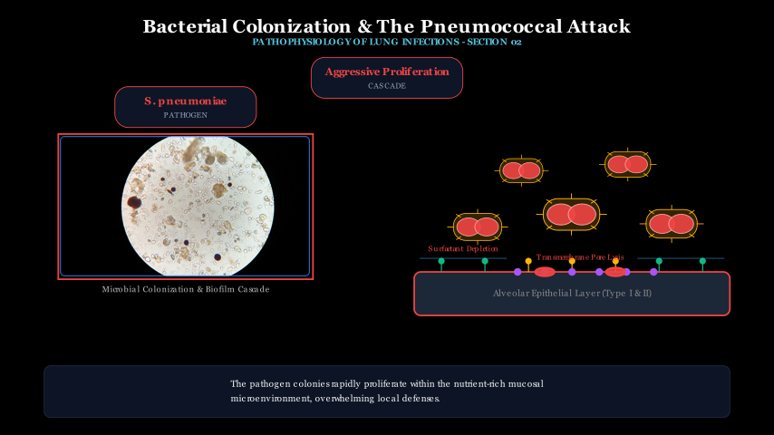
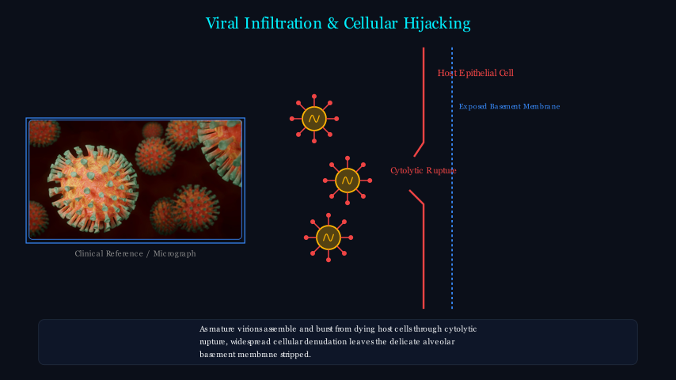
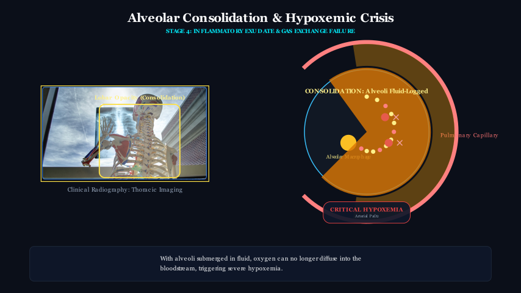
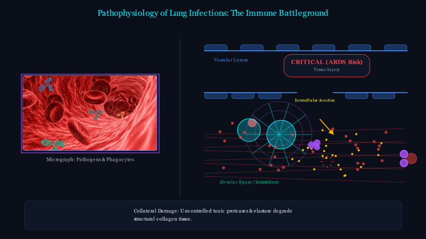
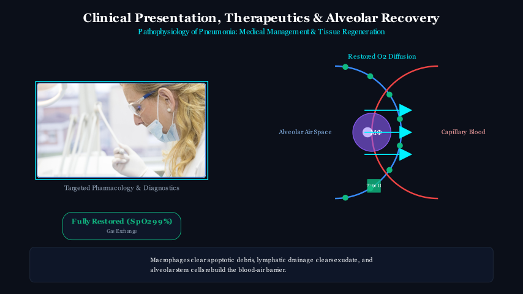
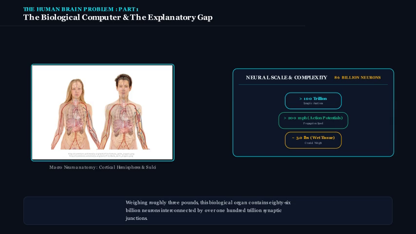
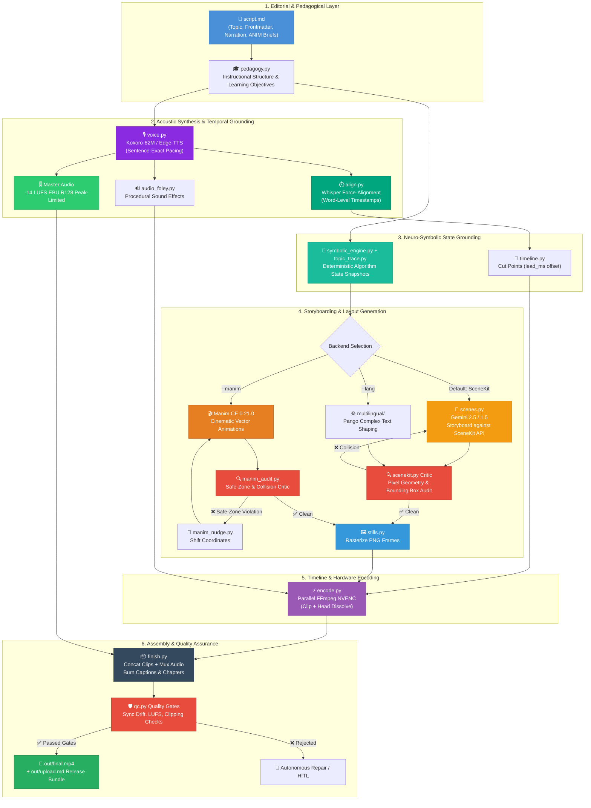
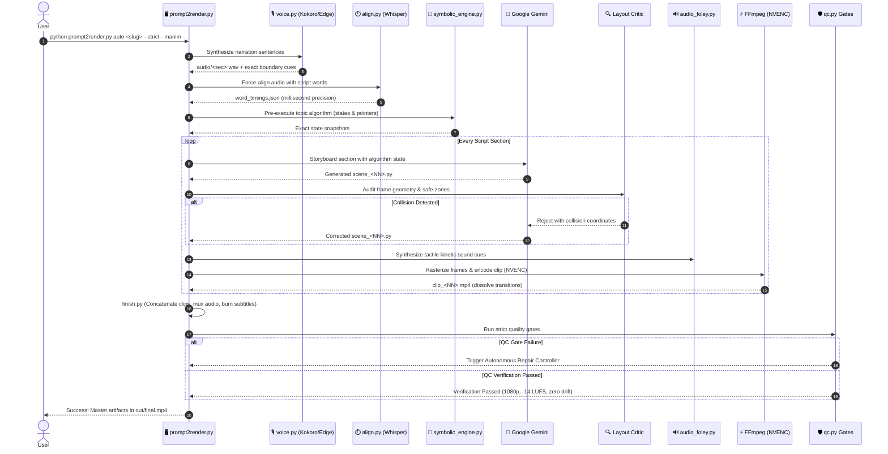

# 🏗️ Prompt2Render — Production Architecture & Engineering Guide

[](https://www.python.org/)
[](https://github.com/)
[](https://www.manim.community/)
[](https://github.com/hexgrad/kokoro)
[](https://github.com/openai/whisper)
[](https://ai.google.dev/)
[](docker-compose.yml)
[](.github/workflows/ci.yml)
[](https://github.com/)

> **Prompt2Render** is an industrial-grade, local-first, end-to-end automated educational video synthesis engine.
>
> It transforms a topic or markdown script (`script.md`) into a broadcast-ready 1080p human-narrated, mathematically animated explainer video (`out/final.mp4`) with millisecond word-level synchronization, deterministic pixel geometry auditing, neuro-symbolic algorithm state grounding, multilingual complex text shaping, and an autonomous self-correction & Human-in-the-Loop (HITL) harness.

---

## 📑 Table of Contents

- [🎥 Visual Showcase & Production Gallery](#-visual-showcase--production-gallery)
  - [Production Master Videos (Final Results)](#production-master-videos-final-results)
  - [Algorithmic & Multilingual Demonstrations](#algorithmic--multilingual-demonstrations)
  - [Frame-Accurate Visual Gallery & Layout Audits](#frame-accurate-visual-gallery--layout-audits)
- [📖 Project Overview & Core Philosophy](#-project-overview--core-philosophy)
- [⚙️ Tech Stack & Systems Matrix](#️-tech-stack--systems-matrix)
- [📁 Directory & Workspace Structure](#-directory--workspace-structure)
- [🧩 System Architecture & Workflows](#-system-architecture--workflows)
  - [End-to-End Pipeline Flowchart](#end-to-end-pipeline-flowchart)
  - [Layered System Architecture](#layered-system-architecture)
  - [Full Generation Sequence Diagram](#full-generation-sequence-diagram)
- [🔄 Autonomous Self-Correction & Closed-Loop HITL Harness](#-autonomous-self-correction--closed-loop-hitl-harness)
  - [Autonomous Repair Controller & Evidence Bundles](#autonomous-repair-controller--evidence-bundles)
  - [Human-in-the-Loop (HITL) Workflow](#human-in-the-loop-hitl-workflow)
  - [Automated Regression Guard](#automated-regression-guard)
- [🔍 Core Subsystems Breakdown](#-core-subsystems-breakdown)
  - [1. CLI Orchestration & Project Management](#1-cli-orchestration--project-management)
  - [2. Acoustic Narration & Audio Mastering](#2-acoustic-narration--audio-mastering)
  - [3. Word-Level Forced Alignment](#3-word-level-forced-alignment)
  - [4. Visual Engines & Layout Criticism](#4-visual-engines--layout-criticism)
  - [5. Manim CE 0.21.0 Cinematic Safe-Zone Contract](#5-manim-ce-0210-cinematic-safe-zone-contract)
  - [6. Multilingual Video Generation Pipeline](#6-multilingual-video-generation-pipeline)
  - [7. Neuro-Symbolic Algorithm Grounding](#7-neuro-symbolic-algorithm-grounding)
  - [8. Procedural Audio Foley & Tactile Sound Effects](#8-procedural-audio-foley--tactile-sound-effects)
  - [9. Local Studio Web Dashboard](#9-local-studio-web-dashboard)
  - [10. External Visual Asset Retrieval & B-Roll Conforming](#10-external-visual-asset-retrieval--b-roll-conforming)
  - [11. Hardware-Accelerated Video Encoding & Assembly](#11-hardware-accelerated-video-encoding--assembly)
- [📊 Empirical Benchmark & Ground-Truth Evaluation](#-empirical-benchmark--ground-truth-evaluation)
- [🚀 Getting Started & Installation](#-getting-started--installation)
  - [Native Windows (PowerShell)](#native-windows-powershell)
  - [Linux / macOS (Bash)](#linux--macos-bash)
  - [Docker & Docker Compose](#docker--docker-compose)
  - [Environment Configuration (`.env`)](#environment-configuration-env)
  - [System Health & Diagnostic Check](#system-health--diagnostic-check)
- [🛠️ CLI Command Reference Guide](#️-cli-command-reference-guide)
  - [Project Scaffolding & Setup](#project-scaffolding--setup)
  - [End-to-End Execution](#end-to-end-execution)
  - [Modular Pipeline Stages](#modular-pipeline-stages)
  - [Self-Correction & Harness Operations](#self-correction--harness-operations)
  - [Escape Hatches & Manual Overrides](#escape-hatches--manual-overrides)
- [🛡️ Quality Gates, Diagnostics & Verification](#️-quality-gates-diagnostics--verification)
- [⚡ Performance, Parallelism & Workstation Acceleration](#-performance-parallelism--workstation-acceleration)
- [🔧 Troubleshooting & Diagnostics Matrix](#-troubleshooting--diagnostics-matrix)
- [🗺️ Roadmap & Milestones](#️-roadmap--milestones)
- [📚 Extended Documentation Links](#-extended-documentation-links)

---

## 🎥 Visual Showcase & Production Gallery

Prompt2Render synthesizes mastered 1080p explainer videos alongside inspectable intermediate frames, layout audits, and per-section clips.

### Production Master Videos (Final Results)

The repository includes 15 fully mastered production explainer videos generated through the complete Prompt2Render pipeline, located in the `Final Results/` directory:

| Video Title | Subject & Pedagogical Focus | Engine & Audio Profile | Direct Link |
| :--- | :--- | :--- | :--- |
| **Compiler Architecture** | Lexing, parsing, Abstract Syntax Trees (AST), semantic checks | Manim CE / -14 LUFS | [▶ Watch Compiler.mp4](Final%20Results/Compiler.mp4) |
| **Deterministic Finite Automata (DFA)** | State transition graphs, alphabet acceptance, formal proofs | Manim CE / -14 LUFS | [▶ Watch DFA.mp4](Final%20Results/DFA.mp4) |
| **Fourier Transform** | Time-to-frequency domain mapping, harmonics, decomposition | Manim CE / -14 LUFS | [▶ Watch FourierTransform.mp4](Final%20Results/FourierTransform.mp4) |
| **Gradient Descent** | Multivariable loss surfaces, learning rate steps, contours | Manim CE / -14 LUFS | [▶ Watch GradientDescent.mp4](Final%20Results/GradientDescent.mp4) |
| **How the Human Heart Works** | Cardiovascular chambers, valvular cycles, hemodynamic flow | Manim + Visuals / -14 LUFS | [▶ Watch HowHeartWorks.mp4](Final%20Results/HowHeartWorks.mp4) |
| **Human Brain Neural Processing** | Synaptic transmission, neural pathways, action potentials | Manim CE / -14 LUFS | [▶ Watch HumanBrain.mp4](Final%20Results/HumanBrain.mp4) |
| **K-Means Clustering (Hindi)** | Unsupervised learning, centroid recalculation in Hindi script | Pango / Hindi Devanagari | [▶ Watch KMeansHindi.mp4](Final%20Results/KMeansHindi.mp4) |
| **Machine Learning (Kashmiri)** | AI fundamentals in Kashmiri language with native typography | Pango / Kashmiri Devanagari | [▶ Watch KashurMl.mp4](Final%20Results/KashurMl.mp4) |
| **Lexical Analysis** | Regex tokenization, lexemes, scanning transitions | Manim CE / -14 LUFS | [▶ Watch LexicalAnalyzer.mp4](Final%20Results/LexicalAnalyzer.mp4) |
| **NginX Architecture** | Reverse proxies, epoll event loops, non-blocking workers | Manim CE / -14 LUFS | [▶ Watch NginX.mp4](Final%20Results/NginX.mp4) |
| **QuickSort Partitioning (Urdu)** | Hoare partitioning, pivot swaps in Urdu Nastaliq/Arabic | Pango / Urdu RTL | [▶ Watch QuickSortUrdu.mp4](Final%20Results/QuickSortUrdu.mp4) |
| **RSA Cryptography** | Modular arithmetic, totient function, public/private keys | Manim CE / -14 LUFS | [▶ Watch RSA-Full-Explainer.mp4](Final%20Results/RSA-Full-Explainer.mp4) |
| **Self-Attention Mechanics** | Query, Key, Value matrix math, softmax scaling, attention maps | Manim CE / -14 LUFS | [▶ Watch Self-Attention.mp4](Final%20Results/Self-Attention.mp4) |
| **Virtual Memory & Paging** | Page tables, TLB hits, frame translation, page faults | Manim CE / -14 LUFS | [▶ Watch Virtualmemory.mp4](Final%20Results/Virtualmemory.mp4) |
| **Backpropagation & Chain Rule** | Computational DAGs, loss gradients, backward pass | Manim CE / -14 LUFS | [▶ Watch backpropagation.mp4](Final%20Results/backpropagation.mp4) |

---

### Algorithmic & Multilingual Demonstrations

| Video Output | Description | Resolution & Profile | Direct Link |
| :--- | :--- | :--- | :--- |
| **Complete Final Master** | Multi-section explainer video with master audio, subtitles, and chapter markers. | 1080p @ 30fps / -14 LUFS | [▶ Watch final.mp4](media/showcase/videos/final.mp4) |
| **Cinematic Bubble Sort** | Algorithm visualization generated with synchronized auditory sound effects (foley). | 480p15 / 1080p Preview | [▶ Watch BubbleSortCinematic.mp4](media/showcase/videos/BubbleSortCinematic_WithSound.mp4) |
| **Hindi Linear Regression** | Hindi multilingual preview demonstrating Devanagari typography and formula preservation. | 1080p @ 30fps / Hindi | [▶ Watch HindiLinearRegression_preview.mp4](media/showcase/videos/HindiLinearRegression_preview.mp4) |
| **Kashmiri Machine Learning** | Kashmiri multilingual preview with native script shaping and localized narration. | 1080p @ 30fps / Kashmiri | [▶ Watch Kashmiri_MachineLearning_preview.mp4](media/showcase/videos/Kashmiri_MachineLearning_preview.mp4) |
| **Urdu Binary Search** | Urdu preview featuring bidirectional RTL text shaping and pointer visualization. | 1080p @ 30fps / Urdu RTL | [▶ Watch UrduBinarySearch_preview.mp4](media/showcase/videos/UrduBinarySearch_preview.mp4) |
| **Modular Section 01** | Section 1 cut clip showing intro text, LaTeX equations, and vector animations. | 480p15 / 1080p | [▶ Watch Scene01.mp4](media/showcase/videos/Scene01.mp4) |
| **High-Fidelity 1080p60** | 60 FPS master render demonstrating smooth Manim vector transformations and sharp typography. | 1080p @ 60fps | [▶ Watch scene_01.mp4](media/showcase/videos/scene_01.mp4) |

---

### Frame-Accurate Visual Gallery & Layout Audits

Production render stills and layout verification audit captures:

| Scene 01: Concept Introduction | Scene 02: Core Mechanics | Scene 03: Algorithmic Steps |
| :---: | :---: | :---: |
|  |  |  |
| *LaTeX typography & safe-zones* | *Dynamic geometric structures* | *Step-by-step state transformation* |

| Scene 04: Edge Cases & Proof | Scene 05: Performance Profiling | Scene 06: Final Summary & Takeaways |
| :---: | :---: | :---: |
|  |  |  |
| *Graph & tree traversal visuals* | *Data structures & complexity curves* | *Recap with safe margins* |

#### Layout Criticism & Visual Collision Auditing
The critic inspects pixel geometry to guarantee labels, arrows, and panels never collide:

| Scene 1 Audit (Frame 10) | Scene 1 Audit (Frame 32) | Scene 1 Audit (Frame 48) |
| :---: | :---: | :---: |
|  |  |  |
| *Initial geometry check* | *Passed zero-overlap collision gate* | *Final scene verification* |

| Scene 2 Audit (Frame 12) | Scene 2 Audit (Frame 30) | Scene 2 Audit (Frame 40) |
| :---: | :---: | :---: |
|  |  |  |
| *Text-box boundary check* | *Intermediate layout verification* | *Final scene verification* |

---

## 📖 Project Overview & Core Philosophy

Generating high-quality instructional videos using naive AI prompt-to-video wrappers fails due to four fundamental flaws:
1. **Visual Hallucination & Collision:** LLMs writing freeform animation code lack spatial awareness. They routinely stack text labels over equations, draw arrows through numbers, and place captions off-screen.
2. **Audio-Visual Desynchronization:** Generating video and audio independently creates pacing drift. Padding video with static holds or speeding up clips breaks the educational rhythm.
3. **Algorithmic Hallucination:** LLMs routinely invent incorrect intermediate data states when illustrating sorting, searching, or graph traversals.
4. **Complex Multilingual Rendering Failures:** Non-Latin scripts (Devanagari, Perso-Arabic) require specialized font shaping and bidirectional rendering, while technical formulas (`$...$`) must remain pristine.

**Prompt2Render resolves these challenges deterministically:**

```
script.md ──> voice ──> align ──> trace ──> scenes ──> stills ──> plan ──> encode ──> finish ──> check
               (TTS,      (word-    (neuro-   (model     (PNG       (frame-   (one clip  (concat,   (quality
               mastered)  level     symbolic  code       frames,    exact     per still, mux,       gates &
                          timing)   states)   critic)    audited)   timing)   dissolve)  caption)   sync)
```

### Key Engineering Innovations:
- **Acoustic Authority & Sample-Accurate Narration:** Voice is synthesized sentence-by-sentence via Kokoro-82M or Edge-TTS. Programmatic pauses are inserted directly into audio buffers rather than estimated, and loudness is normalized to **-14 LUFS** (EBU R128).
- **Word-Level Forced Alignment:** Narration audio is aligned at the millisecond word level using Whisper ASR, ensuring frame transitions occur precisely as key terms are uttered (adjusted with pre-roll `lead_ms`).
- **Neuro-Symbolic Algorithm Grounding:** Algorithms (sorting, searching, BST, Euclidean GCD) are executed deterministically before storyboarding, feeding mathematically verified state snapshots directly into the scene generator.
- **Closed-Loop Pixel & Geometry Critics:** Bounding boxes of rendered text, shapes, panels, and formulas are audited in pixel space. Overlaps are rejected and returned with geometric collision coordinates for automated repair.
- **Dual Visual Engines:** Supports both **SceneKit** (deterministic matplotlib 2D vector primitives) and **Manim Community Edition v0.21.0** (cinematic vector math animations with strict safe-area contracts).
- **Automated Self-Correction & HITL Harness:** A multi-iteration repair controller isolates defective scenes, generates localized repair contracts, re-verifies all dimensions, and automatically rolls back if regressions occur.

---

## ⚙️ Tech Stack & Systems Matrix

| Subsystem | Technology | Version | Purpose & Architecture Role |
| :--- | :--- | :--- | :--- |
| **Animation Engine (Cinematic)** | Manim (Community Edition) | `0.21.0` (pinned) | High-definition mathematical and algorithmic animations |
| **Animation Engine (Geometric)** | SceneKit (Matplotlib / NumPy) | `3.8+` | Deterministic 2D layouts, code panels, registers, and memory maps |
| **Neural TTS Voice** | Kokoro-82M / Edge-TTS | `v0.19+` | Ultra-fast local neural voice synthesis with sample-exact pacing |
| **Audio Force-Alignment** | Whisper ASR (ffmpeg / local) | `base.en` | Millisecond-accurate word-level timestamp alignment |
| **LLM Reasoning & Storyboard** | Google Gemini | `2.5 / 1.5 Pro / Flash` | Script structuring, pedagogical breakdown, and animation code generation |
| **Video & Audio Encoding** | FFmpeg / FFprobe | `6.0+` (NVENC / x264) | Hardware-accelerated clip encoding, dissolve transitions, and muxing |
| **Typography & Math Layout** | MiKTeX / TeX Live (dvisvgm) | LaTeX 2e | Vector rendering of LaTeX equations via `MathTex` / `Tex` |
| **Multilingual Typography** | Pango / HarfBuzz / Noto / Nirmala | Multi-script | Complex text shaping for Hindi, Urdu, Kashmiri, and Arabic |
| **Audio Mastering** | Custom LUFS Limiter (FFmpeg) | EBU R128 | Static gain mastering to YouTube standard `-14 LUFS` & true-peak limiter |
| **Procedural Foley / SFX** | NumPy / SciPy / FFmpeg | Native | Tactile sound effects (whooshes, clicks, chime, pops, sweeps) |
| **Web Studio Dashboard** | FastAPI / Uvicorn / SSE | `0.110+` | Real-time browser studio, job runner, and visual timeline preview |
| **Containerization** | Docker / Docker Compose | Debian Bookworm | Fully reproducible containerized execution with all system dependencies |
| **Computer Vision QA** | OpenCV (`opencv-python-headless`) | `4.8+` | Frame ink fraction analysis, motion delta checking, and visual observation |
| **AST & Layout Validation** | Python AST & Pillow / Shapely | Native | Static code validation and pixel-space polygon collision detection |
| **CI / CD Automation** | GitHub Actions | Ubuntu / Windows | Automated dependency verification, health probe, and pytest execution |

---

## 📁 Directory & Workspace Structure

```
Prompt2Render/
├── prompt2render.py                # Master CLI entrypoint & unified orchestrator
├── prompt2render/                  # Core Python package
│   ├── cli.py                      # Master CLI argument parser (40+ subcommands)
│   ├── cfg.py                      # Global paths, environment configuration, constants
│   ├── project.py                  # Project scaffolding, workspace layout, script parser
│   ├── voice.py                    # Kokoro & Edge-TTS voice synthesis, sentence boundaries
│   ├── textseg.py                  # Linguistic sentence & word tokenization engine
│   ├── mathspeech.py               # LaTeX formula spoken text normalizer
│   ├── abbrev.py                   # Domain abbreviation expansion rules
│   ├── align.py                    # Whisper forced-alignment & temporal reconciliation
│   ├── asrmodel.py                 # Whisper & VAD model caching and validation
│   ├── scenes.py                   # LLM storyboarding, Gemini API interfacing, scene modules
│   ├── scenekit.py                 # Geometric drawing primitives & pixel layout critic
│   ├── manimver.py                 # Supported Manim version guard (0.21.0)
│   ├── manim_audit.py              # Manim safe-zone collision & bounding-box auditor
│   ├── manim_nudge.py              # Automated coordinate shifting for collision repair
│   ├── stills.py                   # Scene module execution & PNG frame rasterization
│   ├── timeline.py                 # Temporal planning & frame-exact cut synchronization
│   ├── encode.py                   # Parallel FFmpeg clip encoding with head dissolves
│   ├── finish.py                   # Stream concatenation, audio muxing, chaptering, SRT/ASS
│   ├── captions.py                 # Subtitle generation from aligned phonetic transcripts
│   ├── audio_foley.py              # Procedural auditory sound effects generator
│   ├── symbolic_engine.py          # Deterministic algorithm execution engine
│   ├── topic_trace.py              # Neuro-symbolic step snapshot & algorithm tracing
│   ├── pedagogy.py                 # Instructional design & script evaluation engine
│   ├── cognitive_signaling.py      # Dual-coding & cognitive load analyzer
│   ├── video_conform.py            # External B-roll video conforming & aspect masking
│   ├── visual_observe.py           # Frame computer vision observer & ink fraction gate
│   ├── visuals.py                  # Visual scene abstraction & rendering helpers
│   ├── assemble.py                 # Audio/video assembly & stream multiplexing
│   ├── qc.py                       # Quality control gates (sync drift, clipping, format)
│   ├── publish.py                  # Export bundle generation (upload.md, thumbnail, tags)
│   ├── doctor.py                   # Environment, dependency, and hardware probe
│   ├── multilingual/               # Multilingual video synthesis package
│   │   ├── __init__.py             # Language registry & font mappings
│   │   ├── generator.py            # Multilingual storyboard & scene generator
│   │   ├── pipeline.py             # End-to-end multilingual orchestrator
│   │   ├── translator.py           # Term-preserving neural translation engine
│   │   ├── voice_service.py        # Multilingual TTS (Edge-TTS & Kokoro)
│   │   ├── visual_qa.py            # Non-Latin script visual QA & clipping detector
│   │   └── repair.py               # Multilingual visual layout repair engine
│   ├── web/                        # Local Studio Web Dashboard
│   │   ├── app.py                  # FastAPI backend with async job manager & SSE streaming
│   │   └── static/                 # Web Studio frontend UI assets
│   ├── harness/                    # Autonomous self-correction & evaluation engine
│   │   ├── repair_controller.py    # Multi-iteration repair loop & change contract planner
│   │   ├── evidence.py             # Diagnostic evidence bundle extractor
│   │   ├── finding.py              # Normalized error findings & severity scoring
│   │   ├── layout_zones.py         # Visual safe-area coordinate system
│   │   ├── hitl.py                 # Human-in-the-loop repair feedback parser
│   │   └── regression.py           # Pre/post repair regression detector
│   ├── assets/                     # Visual widgets, fonts, sound effects, and mobjects
│   └── tests/                      # Core test suites (contracts, layout, sync, foley, harness)
├── Final Results/                  # 15 fully mastered production explainer MP4 videos
├── media/                          # Visual and audio showcase media
│   ├── images/                     # Rendered stills, audit screenshots, test frames
│   ├── showcase/                   # Demonstrations, previews, and visual benchmarks
│   └── videos/                     # Rendered scene MP4s, clips, and final masters
├── projects/                       # Working project workspaces (<slug>/script.md, etc.)
├── topics/                         # Topic backlog queue (backlog.yaml)
├── tools/                          # Diagnostic scripts, ablations, and baseline runners
├── Dockerfile                      # Self-contained reproducible Docker image
├── docker-compose.yml              # Container composition for Studio Web Dashboard
├── .github/workflows/ci.yml        # Continuous integration test & health workflow
├── setup.ps1                       # Windows native PowerShell automated installer
├── setup.sh                        # Linux / macOS automated installer
├── requirements.txt                # Pinned dependencies
├── PROJECT_ARCHITECTURE.md         # Exhaustive architectural specification & file reference
├── project_cmds.md                 # Complete CLI & utility command reference
└── HITL_WORKFLOW.md                # Human-In-The-Loop interactive repair guide
```

---

## 🧩 System Architecture & Workflows

Prompt2Render coordinates a multi-stage deterministic and AI pipeline where each stage transforms structured data, writes cached disk artifacts, and validates properties before handing off downstream.

### End-to-End Pipeline Flowchart



---

### Layered System Architecture

```mermaid
block-beta
    columns 1

    block:CLIENT["🌐 USER INTERACTION, WEB STUDIO & CLI LAYER"]
        A["prompt2render.py (CLI Commands: new, auto, build, repair, multilingual, serve)"]
        A2["prompt2render/web/app.py (FastAPI Studio Dashboard, SSE Progress, Video Player)"]
    end

    space

    block:ORCH["🛡️ ORCHESTRATION & PROJECT MANAGEMENT"]
        B["project.py (Workspace Scaffolding, script.md Frontmatter & AST Parser)"]
        C["cfg.py (Environment Variables, PATH Resolution, Hardware Capability Detector)"]
    end

    space

    block:AUDIO_LAYER["🎙️ ACOUSTIC & PHONETIC LAYER"]
        D["voice.py + mathspeech.py (Kokoro-82M / Edge-TTS with LaTeX normalization)"]
        E["align.py (Whisper Model Alignment & Intra-Sentence Word Reconciliation)"]
        F["audio_foley.py (Procedural Audio Foley & Tactile Sound Effects)"]
        G["captions.py (SRT / ASS Subtitle Generators with Millisecond Anchoring)"]
    end

    space

    block:VISUAL_LAYER["🎨 VISUAL GENERATION & RENDERING ENGINES"]
        H["symbolic_engine.py + topic_trace.py (Neuro-Symbolic Algorithm Grounding)"]
        I["scenes.py + scenekit.py (SceneKit 2D Primitives & Polygon Layout Critic)"]
        J["manim_audit.py + manim_nudge.py (Manim CE 0.21.0 Cinematic Animation & Safe-Zones)"]
        K["multilingual/ (Pango / HarfBuzz Complex Text Shaping & Font Mapping)"]
    end

    space

    block:HARNESS_LAYER["🔄 AUTONOMOUS SELF-CORRECTION & HITL HARNESS"]
        L["repair_controller.py (Targeted Multi-Iteration Repair & Evidence Bundles)"]
        M["hitl.py (Human-in-the-Loop Feedback Contract & Partial Re-rendering)"]
        N["qc.py (Verification Gates: Caption Drift, Peak LUFS, Frame Continuity)"]
    end

    space

    block:STORAGE["💾 ARTIFACT & STORAGE LAYER"]
        O["Final Results/ (Master Production Videos)"]
        P["media/ (Permanent Showcase Assets: images/, videos/)"]
        Q["projects/<slug>/ (Workspace build/, audio/, sections/, out/)"]
    end

    CLIENT --> ORCH
    ORCH --> AUDIO_LAYER
    ORCH --> VISUAL_LAYER
    VISUAL_LAYER --> HARNESS_LAYER
    AUDIO_LAYER --> HARNESS_LAYER
    HARNESS_LAYER --> STORAGE

    style CLIENT fill:#4A90D9,color:#FFFFFF
    style ORCH fill:#7B68EE,color:#FFFFFF
    style AUDIO_LAYER fill:#8A2BE2,color:#FFFFFF
    style VISUAL_LAYER fill:#F39C12,color:#FFFFFF
    style HARNESS_LAYER fill:#2ECC71,color:#FFFFFF
    style STORAGE fill:#34495E,color:#FFFFFF
```



---

### Full Generation Sequence Diagram



---

## 🔄 Autonomous Self-Correction & Closed-Loop HITL Harness

### Autonomous Repair Controller & Evidence Bundles

When an LLM writes invalid coordinates or causes text-label collisions, traditional pipelines fail completely. Prompt2Render features a native **Self-Correction Harness** (`prompt2render/harness/`):

```
GENERATE ──> RENDER ──> VERIFY ──> EVIDENCE ──> TARGETED REPAIR ──> REGRESSION CHECK ──> ACCEPT / ROLLBACK
```

1. **Deterministic Verification:** Static AST analyzers, pixel critics, and computer vision observers detect issues (e.g. `TEXT_OVERFLOW`, `CAPTION_COLLISION`, `INK_TOO_LOW`).
2. **Diagnostic Evidence Bundles:** The harness constructs a diagnostic context containing the exact failed frame, line numbers, and bounding-box coordinates.
3. **Localized Change Contracts:** Gemini receives a strict contract (`scope: LOCAL`) with locked passing properties to prevent repairing one section by corrupting another.
4. **Isolated Sidecar Execution:** Repaired candidates render in an isolated workspace without modifying production disk artifacts until verified.

---

### Human-in-the-Loop (HITL) Workflow

When you want to tweak specific sections without re-rendering the entire video:

1. In your project directory (`projects/<slug>/`), create `hitl_feedback.json`:

```json
{
  "03": {
    "status": "reject",
    "reason": "The binary tree nodes overlap the title. Move the tree down by 1.5 units."
  },
  "05": {
    "status": "reject",
    "reason": "The explanation mentions a stack, but an array was drawn. Change to a vertical stack."
  }
}
```

2. Run the harness repair command:
```powershell
python prompt2render.py auto "<slug>" --harness --strict --manim
```

**The pipeline will:**
- **Skip** sections `01`, `02`, `04`, and `06` (preserving valid renders).
- Re-prompt Gemini with targeted feedback for sections `03` and `05`.
- Re-render only rejected clips and re-mux the master video.
- Mark your feedback resolved.

#### HITL Execution Modes
Control HITL gate enforcement via `--hitl-mode`:
* `autonomous` (default): Fully automated self-repair; HITL is consulted only if `hitl_feedback.json` is explicitly present.
* `human_on_failure`: If automated repair retries fail, drafts `hitl_review_needed.json` with diagnostic evidence and pauses for input.
* `human_approval`: Strict sign-off mode; blocks final publish until every section has an explicit `"status": "accept"`.

---

### Automated Regression Guard

If a candidate repair fixes a syntax error but causes a new spatial collision or timing drift, the harness automatically **rolls back** to the last known good revision (`revisions.json`), preventing degradation across iterations.

---

## 🔍 Core Subsystems Breakdown

### 1. CLI Orchestration & Project Management
* **`prompt2render/cli.py` & `project.py`:** Master command dispatcher supporting 40+ subcommands with mtime/hash caching. Automatically skips stages whose input artifacts have not changed.
* **Aspect Ratio Profiles:** Supports widescreen 16:9 (`1920x1080`), vertical mobile shorts 9:16 (`1080x1920`), and square 1:1 (`1080x1080`) via `--aspect`.

### 2. Acoustic Narration & Audio Mastering
* **`prompt2render/voice.py`:** Sentence-by-sentence synthesis using Kokoro-82M or Edge-TTS with programmatic inter-sentence pauses.
* **`prompt2render/mathspeech.py`:** Normalizes LaTeX math expressions (`$\frac{a}{b}$`, `$\sum_{i=1}^n$`) into natural spoken phonetic equivalents.
* **EBU R128 Mastering:** Masters total programme loudness to **-14.0 LUFS** (YouTube standard) with a lookahead true-peak limiter.

### 3. Word-Level Forced Alignment
* **`prompt2render/align.py` & `asrmodel.py`:** Employs Whisper ASR to align phonemes to millisecond timestamps.
* **Temporal Reconciliation:** Whisper adjusts intra-sentence cut positions, but synthesis boundaries strictly anchor the video timeline.

### 4. Visual Engines & Layout Criticism
* **`prompt2render/scenes.py` & `scenekit.py`:** Storyboards script section briefs (`> ANIM:`) into executable SceneKit drawing code.
* **Pixel Geometry Critic:** Audits pixel coordinates of drawn elements (`k.box`, `k.array`, `k.arrow`, `k.panel`, `k.label`) to guarantee zero-overlap geometry.

### 5. Manim CE 0.21.0 Cinematic Safe-Zone Contract
* **`prompt2render/manimver.py`, `manim_audit.py` & `manim_nudge.py`:** Enforces Manim Community 0.21.0 compatibility.
* **Coordinate Nudging:** If a subtitle safe-zone collision occurs, `manim_nudge.py` shifts mobject coordinates upward automatically before triggering re-renders.

### 6. Multilingual Video Generation Pipeline
* **`prompt2render/multilingual/`:** First-class support for English (`en`), Hindi (`hi`), Urdu (`ur`), Arabic (`ar`), and Kashmiri (`ks`) with dual-script selection (`Deva` vs `Arab`).
* **Pango Text Shaping:** Automatically selects platform fonts (`Nirmala UI`, `Segoe UI`, `Arial`) with bidirectional RTL rendering.
* **Formula Preservation:** Context-aware token masking protects LaTeX math formulas (`$...$`) from corruption during translation.
* **Visual QA (`visual_qa.py`):** Computer vision post-render inspection flags clipping, blank frames, or low ink fraction.

### 7. Neuro-Symbolic Algorithm Grounding
* **`prompt2render/symbolic_engine.py` & `topic_trace.py`:** Deterministically simulates algorithmic steps (Bubble Sort, QuickSort, Binary Search, Tree Traversal, Euclidean GCD).
* Injects ground-truth array pointers and state transitions into the prompt, eliminating algorithmic hallucination.

### 8. Procedural Audio Foley & Tactile Sound Effects
* **`prompt2render/audio_foley.py`:** Procedurally generates synchronized auditory sound cues (swaps, pops, chimes, whooshes) matching on-screen animation transitions.

### 9. Local Studio Web Dashboard
* **`prompt2render/web/app.py`:** Local FastAPI + SSE studio dashboard (`prompt2render serve`).
* Provides real-time job progress streaming, interactive video and audio previews, and a multilingual video generator modal.

### 10. External Visual Asset Retrieval & B-Roll Conforming
* **`plugins/retriever_external_asset` & `video_conform.py`:** Queries Pixabay, Pexels, and Unsplash for stock video/photos, normalizes aspect ratios with vignette masks, and generates attribution logs (`attributions.md`).

### 11. Hardware-Accelerated Video Encoding & Assembly
* **`prompt2render/encode.py`, `finish.py` & `assemble.py`:** Auto-detects NVIDIA NVENC for parallel hardware encoding (`--jobs 3`) with head dissolve transitions. Multiplexes 48kHz audio and embeds chapters.

---

## 📊 Empirical Benchmark & Ground-Truth Evaluation

To validate multi-modal animation, 3D camera choreography, B-roll conforming, and real-time audio synchronization, Prompt2Render was evaluated on a comprehensive 9-section benchmark: **"How a Neural Network Learns: From Input to Prediction"**.

### End-to-End Benchmark Execution Matrix

| Sec | Chapter Title | Media Architecture | Engine | Rendered Output |
|:---:|:---|:---:|:---:|:---|
| **01** | The Problem: Bridging Pixels to Perception | Split Stage Comparison | Manim + SplitStage | `01/scene_01.mp4` (19.6s) |
| **02** | The Input Layer: Numerical Feature Mapping | 2D Continuous Vector | Manim CE 0.21.0 | `02/scene_02.mp4` (21.2s) |
| **03** | Hidden Layers: Folding in 3D Space | 3D Graph + Azimuth Orbit | Manim `ThreeDScene` | `03/scene_03.mp4` (18.2s) |
| **04** | Weights & Biases: Synaptic Knobs | Dynamic Synapse Pulses | Manim CE 0.21.0 | `04/scene_04.mp4` (18.0s) |
| **05** | Forward Propagation: Cascading Signals | ReLU Non-linear Flow | Manim CE 0.21.0 | `05/scene_05.mp4` (19.3s) |
| **06** | Prediction: Probability Distribution | Softmax Bar Chart | Manim + SplitStage | `06/scene_06.mp4` (17.1s) |
| **07** | Training: Navigating the 3D Loss Landscape | 3D Parametric Surface | Manim `ThreeDScene` | `07/scene_07.mp4` (16.5s) |
| **08** | Real-World Applications | 1080p 30fps B-Roll Video | FFmpeg Video Conformer | `08/scene_08.mp4` (17.7s) |
| **09** | Summary: Architecture of Artificial Thought | Infographic Stage | Manim CE 0.21.0 | `09/scene_09.mp4` (18.6s) |

### Measured Empirical Verification Metrics (`qc.json`)

- **Master Output**: `projects/how-neural-networks-learn/out/final.mp4` (166.70s / 2.78 min)
- **Audio-to-Video Delta**: **25 ms** (Video 166.700s vs Audio 166.725s)
- **Per-Section Synchronization**: **9 / 9 sections** aligned to exact audio sentence boundaries
- **Loudness Compliance**: **-14.1 LUFS**, true peak **-1.7 dBTP** (target: -14.0 LUFS EBU R128)
- **Audio Clipping & Dead Air**: **0 clipped samples**, 0 stretches of dead air > 1.5s
- **Caption Drift**: **0 ms max drift**, p95 **0 ms** across 25 sentences / 47 cards
- **Layout & Geometry Audit**: All bounding boxes and continuous 3D transforms passed collision gates

---

## 🚀 Getting Started & Installation

### Native Windows (PowerShell)

Open PowerShell as Administrator and run the automated bootstrap script:

```powershell
Set-ExecutionPolicy -Scope Process -ExecutionPolicy Bypass
.\setup.ps1
```

*This installs Python 3.12, Git, FFmpeg, MiKTeX, and Manim via `winget`, configures Python virtual environments, and downloads local models.*

Activate the virtual environment:
```powershell
.\.venv\Scripts\Activate.ps1
```

---

### Linux / macOS (Bash)

```bash
chmod +x setup.sh
./setup.sh
source .venv/bin/activate
```

---

### Docker & Docker Compose

Deploy Prompt2Render in a self-contained, reproducible Linux container with all LaTeX, FFmpeg, and Manim dependencies pre-configured:

```bash
# Build the container image
docker compose build

# Start the Prompt2Render Studio Web Dashboard in the background
docker compose up -d

# Open the studio in your browser:
# http://localhost:8000

# View real-time container logs
docker compose logs -f

# Shut down the container
docker compose down
```

---

### Environment Configuration (`.env`)

Create a `.env` file in the project root:

```env
# Google Gemini API Key (Required for storyboarding & AI drafting)
GEMINI_API_KEY=your_primary_gemini_key_here

# Optional: Backup keys for automatic rate-limit failover
GEMINI_API_KEY_BACKUP1=your_backup_key_1
GEMINI_API_KEY_BACKUP2=your_backup_key_2

# Voice Model Configuration
P2R_VOICE=af_heart
P2R_VOICE_JOBS=1

# Optional: Stock asset retrieval keys
PIXABAY_API_KEY=your_pixabay_key
PEXELS_API_KEY=your_pexels_key
UNSPLASH_ACCESS_KEY=your_unsplash_key
```

---

### System Health & Diagnostic Check

Confirm your local toolchain, GPU encoders, LaTeX binaries, and TTS weights are healthy:

```bash
# General environment diagnostic
python prompt2render.py doctor

# Full end-to-end rendering probe (renders a 1080p Manim test scene & validates with ffprobe)
python prompt2render.py doctor --render-test
```

---

## 🛠️ CLI Command Reference Guide

### Project Scaffolding & Setup

| Command | Syntax | Purpose |
| :--- | :--- | :--- |
| **`new`** | `python prompt2render.py new <slug> [OPTIONS]` | Scaffolds workspace, metadata headers, and `script.md`. Flags: `--title`, `--minutes`, `--sections`, `--ai`, `--aspect {16:9, 9:16, 1:1}` |
| **`doctor`** | `python prompt2render.py doctor [--render-test]` | Audits Python, FFmpeg, LaTeX, Manim, GPU encoders, and models. |
| **`models`** | `python prompt2render.py models [OPTIONS]` | Downloads Whisper ASR, Silero VAD, and Kokoro weights. Flags: `--asr`, `--vad`, `--kokoro`, `--kokoro-int8` |
| **`languages`**| `python prompt2render.py languages` | Lists supported multilingual languages, scripts, and font mappings. |
| **`voices`** | `python prompt2render.py voices` | Lists all available Kokoro neural voices. |

### End-to-End Execution

| Command | Syntax | Purpose |
| :--- | :--- | :--- |
| **`auto`** | `python prompt2render.py auto <slug> [OPTIONS]` | One-shot generation: outlines, drafts, builds, and verifies end-to-end. Flags: `--minutes`, `--manim`, `--harness`, `--strict`, `--aspect`, `--hitl-mode` |
| **`build`** | `python prompt2render.py build <slug> [OPTIONS]` | Builds video from existing `script.md` through all cached stages. Flags: `--manim`, `--harness`, `--strict`, `--jobs` |
| **`multilingual`**| `python prompt2render.py multilingual "<prompt>" [OPTIONS]` | One-shot multilingual video generation from topic prompt. Flags: `--lang {en, hi, ur, ar, ks}`, `--script {Deva, Arab}`, `--minutes` |

### Modular Pipeline Stages

| Command | Syntax | Purpose |
| :--- | :--- | :--- |
| **`draft`** | `python prompt2render.py draft <slug> [--force]` | Uses Gemini to draft narration into unwritten script sections. |
| **`voice`** | `python prompt2render.py voice <slug> [OPTIONS]` | Synthesizes sentence-exact audio and normalizes to -14 LUFS. Flags: `--voice`, `--speed`, `--backend {kokoro, edge, own}`, `--only` |
| **`align`** | `python prompt2render.py align <slug> [OPTIONS]` | Word-level Whisper forced alignment. Flags: `--asr-jobs`, `--no-asr`, `--only` |
| **`scenes`** | `python prompt2render.py scenes <slug> [OPTIONS]` | Prompts Gemini to storyboard SceneKit code with layout critique. Flags: `--section`, `--jobs`, `--retries` |
| **`stills`** | `python prompt2render.py stills <slug> [OPTIONS]` | Executes scene code and rasterizes PNG frames with bounding checks. Flags: `--section`, `--check`, `--jobs` |
| **`plan`** | `python prompt2render.py plan <slug> [OPTIONS]` | Computes cut timestamps synchronized to word timing. Flags: `--motion`, `--lead-ms` |
| **`encode`** | `python prompt2render.py encode <slug> [OPTIONS]` | Encodes video clips with dissolve heads via FFmpeg NVENC. Flags: `--all`, `--preview`, `--jobs` |
| **`finish`** | `python prompt2render.py finish <slug> [OPTIONS]` | Assembles master `final.mp4`, burns subtitles, and embeds chapters. Flags: `--burn`, `--style {srt, ass}` |
| **`check`** | `python prompt2render.py check <slug> [--strict]` | Evaluates strict quality assurance gates on the finished video. |
| **`publish`** | `python prompt2render.py publish <slug>` | Generates YouTube upload packet (`upload.md`, thumbnail, tags). |
| **`serve`** | `python prompt2render.py serve [OPTIONS]` | Starts local Studio Web Dashboard. Flags: `--host`, `--port 8787`, `--reload` |

### Self-Correction & Harness Operations

| Command | Syntax | Purpose |
| :--- | :--- | :--- |
| **`repair`** | `python prompt2render.py repair <slug> --section <n> [OPTIONS]` | Runs one regression-safe repair cycle for a scene. Flags: `--manim`, `--dry-run` |
| **`verify`** | `python prompt2render.py verify <slug> --section <n>` | Deterministically audits a single scene's artifacts without LLM calls. |
| **`rollback`** | `python prompt2render.py rollback <slug> --section <n> --revision <rev>` | Restores a previously passing scene revision from `revisions.json`. |
| **`replay`** | `python prompt2render.py replay <slug> --section <n>` | Deterministically re-renders and re-verifies a scene from disk source. |
| **`revisions`**| `python prompt2render.py revisions <slug> --section <n>` | Inspects complete revision history, repair decisions, and diffs. |
| **`events`** | `python prompt2render.py events <slug> [OPTIONS]` | Queries durable harness event log (`build/harness/events.jsonl`). |
| **`harness`** | `python prompt2render.py harness <slug> [--config <path>]` | Executes standalone harness DAG across all scenes. |
| **`harness-check`**| `python prompt2render.py harness-check <slug>` | Audits project disk artifacts against harness manifests. |
| **`report`** | `python prompt2render.py report <slug> [--json] [--rebuild]` | Prints experiment repair summary, scores, and execution timings. |
| **`ablation`**| `python prompt2render.py ablation <slug> [--config <path>]` | Runs 4-condition spatial vs. lifecycle detection ablation matrix. |

### Escape Hatches & Manual Overrides

| Command | Syntax | Purpose |
| :--- | :--- | :--- |
| **`import`** | `python prompt2render.py import <slug> <src_dir>` | Imports pre-rendered section MP4 clips into `projects/<slug>/sections/`. |
| **`placeholders`**| `python prompt2render.py placeholders <slug>` | Generates fallback title cards for missing sections. |
| **`manim`** | `python prompt2render.py manim <slug> <file> <class> <idx>` | Renders a hand-authored Manim scene class and assigns it to a section. |
| **`assemble`** | `python prompt2render.py assemble <slug> [--burn]` | Legacy assembly path: muxes imported clips against `master.wav`. |

---

## 🛡️ Quality Gates, Diagnostics & Verification

The final gate `prompt2render check --strict` validates the output against broadcast standards:

```
[PASS] Codec Check        : H.264 High Profile / AAC 48kHz Stereo
[PASS] Geometry Check     : Exactly 1920x1080 @ 30.00 fps
[PASS] Loudness Gate      : -14.1 LUFS Integrated Loudness (+/- 0.5 LUFS)
[PASS] True Peak Check    : <= -1.0 dBFS True Peak (Zero clipping)
[PASS] Caption Sync Drift : Max drift < 42ms across all sentence boundaries
[PASS] Visual Overlap     : Continuous bounding-box collision detection and safe-zone audit
```

---

## ⚡ Performance, Parallelism & Workstation Acceleration

Prompt2Render is tuned for maximum throughput on local desktop workstations:

| Subsystem | Bottleneck | Acceleration Mechanism | Recommended Setting |
| :--- | :--- | :--- | :--- |
| **Video Encoding** | CPU Video Compression | Hardware NVENC encoder on NVIDIA GPUs | `--jobs 3` (auto-detected) |
| **Speech Alignment** | Whisper Transcription | Multi-worker split transcription across section boundaries | `--asr-jobs 4` |
| **Voice Synthesis** | Neural Tokenizer & Model | Sentence-level multi-process Kokoro synthesis | `P2R_VOICE_JOBS=3` in `.env` |
| **Layout Rasterization**| Matplotlib Backend | Direct raster caching without redrawing | Default enabled (`P2R_PNG_EXACT=0`) |
| **Storyboarding** | Gemini API Network Latency | Asynchronous concurrent section requests | `--jobs 3` |
| **Quality Control** | FFprobe Decode Passes | Unified single-pass audio + video verification | Default enabled |

---

## 🔧 Troubleshooting & Diagnostics Matrix

| Symptom | Probable Cause | Corrective Action |
| :--- | :--- | :--- |
| `latex failed` during Manim render | Missing LaTeX packages or `dvisvgm` | Windows: Allow MiKTeX auto-install prompt ("always install"). Linux: `sudo apt install texlive-latex-extra texlive-science`. |
| `manim not found` | Virtual environment not active | Activate virtual environment: `.\.venv\Scripts\Activate.ps1` or `source .venv/bin/activate`. |
| `Manim version mismatch` | System targets 0.21.0 | Run `pip install "manim==0.21.0"`. If intentionally testing 0.19.0: set `P2R_MANIM_VERSION=0.19.0`. |
| `Text runs off frame` | Unconstrained generated layout | Run `python prompt2render.py repair <slug> --section <n> --manim` to execute safe-zone nudging. |
| `Caption drift detected` | Narration audio replaced after alignment | Re-run alignment: `python prompt2render.py align <slug>` then `plan`. |
| `Gemini 429 Rate-Limited` | Exceeded API quota per minute | Add fallback keys (`GEMINI_API_KEY_BACKUP1`) in `.env` or throttle storyboarding: `--jobs 1`. |
| `Missing local model` | Weights not yet cached locally | Run `python prompt2render.py models --asr base.en --vad --kokoro`. |

---

## 🗺️ Roadmap & Milestones

- [x] **Sample-Accurate Neural Narration:** Local Kokoro-82M & Edge-TTS integration with -14 LUFS mastering.
- [x] **Closed-Loop Geometric Critic:** Automatic polygon intersection audits for 2D layouts.
- [x] **Manim Community 0.21.0 Support:** Safe-area bounded layout contract system.
- [x] **Autonomous Self-Correction Loop:** Targeted LLM repairs with regression rollback protection.
- [x] **Human-In-The-Loop (HITL):** Selective section repair via `hitl_feedback.json` and `--hitl-mode`.
- [x] **Multilingual Video Synthesis Engine:** First-class support for Hindi, Urdu, Kashmiri, and Arabic with Pango complex text shaping.
- [x] **Neuro-Symbolic Algorithm Grounding:** Deterministic algorithm state simulation to eliminate animation hallucinations.
- [x] **Procedural Audio Foley:** Dynamic sound effects generator synchronized to state transitions.
- [x] **Interactive Web Studio Dashboard (`prompt2render serve`):** FastAPI + SSE streaming dashboard with preview player and job manager.
- [x] **Containerized Docker Pipeline:** Pre-packaged Debian Bookworm container with CUDA, FFmpeg, TeX Live, and Manim.
- [x] **Automated CI Quality Suite:** Cross-platform GitHub Actions workflow.
- [ ] **Multi-Voice Pedagogical Dialogue:** Support for multi-speaker conversational teacher-student pedagogy.
- [ ] **Distributed Cloud Rendering:** Worker pool rendering support across multiple remote GPU nodes.

---

## 📚 Extended Documentation Links

For in-depth architectural specifications and exhaustive command guides, refer to:
* **[Complete Project Architecture & File Reference (`PROJECT_ARCHITECTURE.md`)](PROJECT_ARCHITECTURE.md):** 90+ KB comprehensive guide detailing every module, DAG dependency, and data structure.
* **[CLI & Command Reference Guide (`project_cmds.md`)](project_cmds.md):** Exhaustive syntax, flags, standalone scripts, and practical workflows.
* **[HITL Workflow Specification (`HITL_WORKFLOW.md`)](HITL_WORKFLOW.md):** Interactive human-in-the-loop repair instructions.

---

<div align="center">

**Prompt2Render** — *Deterministic, Frame-Accurate Educational Video Engineering.*

</div>
