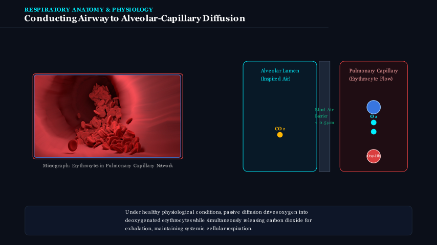
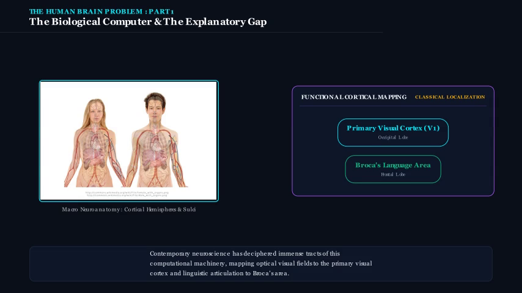
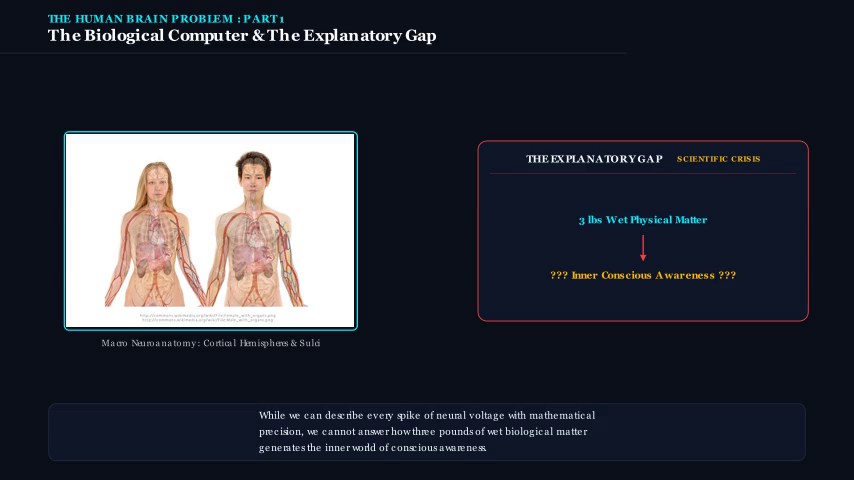
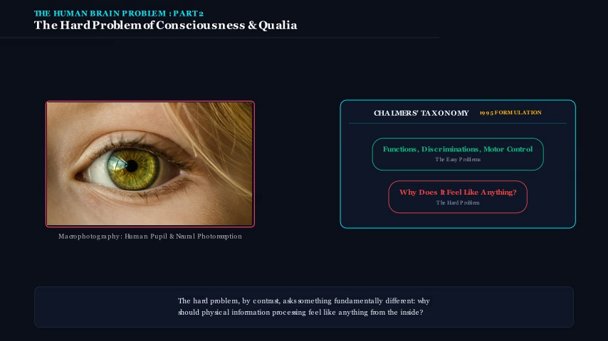
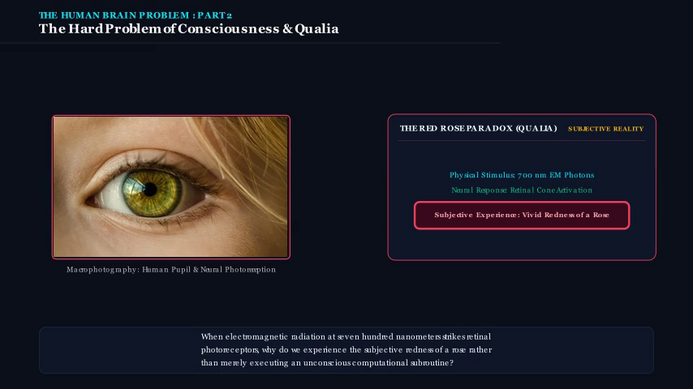
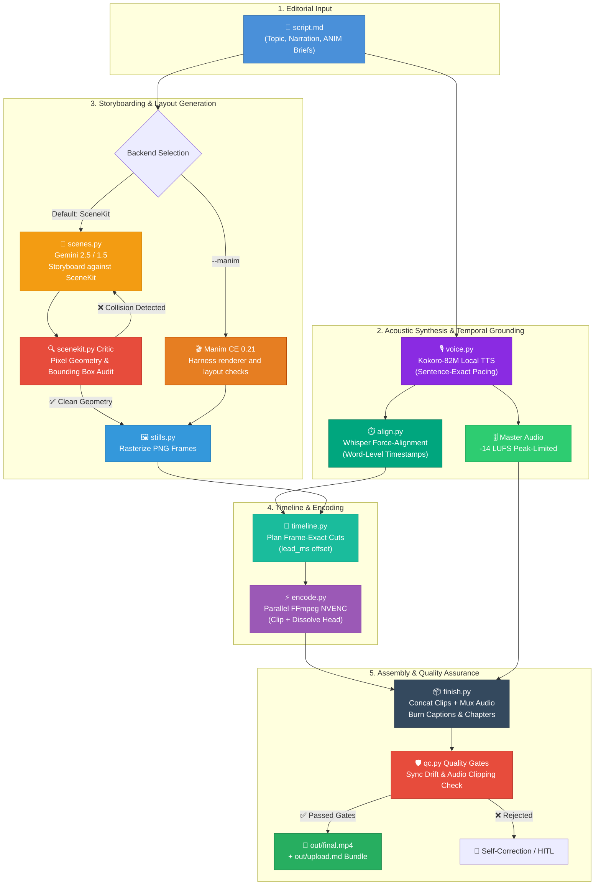
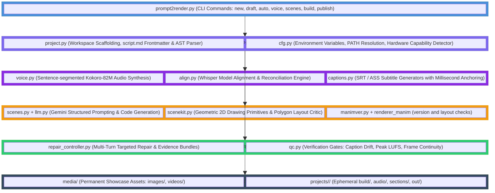
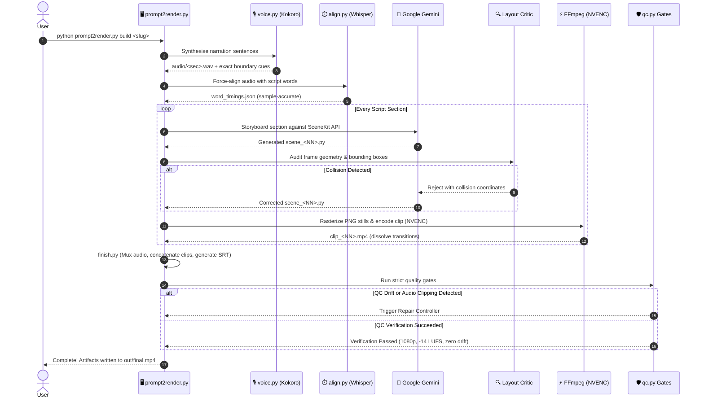

# 🏗️ Prompt2Render — Architecture & Engineering Guide

[](https://www.python.org/)
[](https://github.com/)
[](https://www.manim.community/)
[-8A2BE2)](https://github.com/hexgrad/kokoro)
[](https://github.com/openai/whisper)
[](https://ai.google.dev/)
[](#-system-architecture)
[](https://github.com/)

> **Prompt2Render** is an industrial, local-first, end-to-end video synthesis pipeline designed for producing frame-accurate, mathematically animated, and human-narrated educational videos.
>
> Unlike unconstrained "prompt-to-video" diffusion or raw LLM-to-Manim wrappers, Prompt2Render combines **sample-accurate neural voice synthesis (Kokoro-82M)**, **word-level force alignment (Whisper)**, a **closed-loop layout critic with pixel geometry auditing**, and an **autonomous self-correction harness** to guarantee production-ready video artifacts without text collisions, audio drift, or hallucinatory layouts.

> **Repository note:** rendered media, downloaded models, and per-project build outputs are generated locally and are intentionally excluded from Git. Showcase paths below therefore apply after generating the corresponding artifacts in a working checkout.

---

## 📑 Table of Contents

- [🎥 Visual Showcase & Media Gallery](#-visual-showcase--media-gallery)
  - [Rendered Video Demonstrations](#rendered-video-demonstrations)
  - [Frame-Accurate Visual Gallery](#frame-accurate-visual-gallery)
  - [Adding Your Own Media (Videos & Photos)](#adding-your-own-media-videos--photos)
- [📖 Project Overview & Core Philosophy](#-project-overview--core-philosophy)
- [⚙️ Tech Stack & Systems Matrix](#️-tech-stack--systems-matrix)
- [📁 Directory & Workspace Structure](#-directory--workspace-structure)
- [🧩 System Architecture & Workflows](#-system-architecture--workflows)
  - [End-to-End Pipeline Flowchart](#end-to-end-pipeline-flowchart)
  - [Layered System Architecture](#layered-system-architecture)
  - [Full Generation Sequence Diagram](#full-generation-sequence-diagram)
- [🔄 Closed-Loop Self-Correction & HITL Workflow](#-closed-loop-self-correction--hitl-workflow)
  - [Autonomous Repair Controller](#autonomous-repair-controller)
  - [Human-in-the-Loop (HITL) Scene Repair](#human-in-the-loop-hitl-scene-repair)
- [🔍 Core Subsystems Breakdown](#-core-subsystems-breakdown)
- [🚀 Getting Started & Installation](#-getting-started--installation)
  - [Windows (Native PowerShell)](#windows-native-powershell)
  - [Linux / macOS](#linux--macos)
  - [Environment Configuration](#environment-configuration)
  - [Verification & Health Check](#verification--health-check)
- [🛠️ CLI Command Reference](#️-cli-command-reference)
- [🛡️ Quality Gates, Diagnostics & Verification](#️-quality-gates-diagnostics--verification)
- [⚡ Performance, Parallelism & Hardware Acceleration](#-performance-parallelism--hardware-acceleration)
- [🔧 Troubleshooting & Diagnostics Matrix](#-troubleshooting--diagnostics-matrix)
- [🗺️ Roadmap & Future Horizons](#️-roadmap--future-horizons)

---

## 🎥 Visual Showcase & Media Gallery

Prompt2Render outputs fully mastered 1080p videos alongside inspectable intermediate frames, layout audits, and per-section clips.

### Rendered Video Demonstrations

| Video Output | Description | Resolution & Profile | Direct Link |
| :--- | :--- | :--- | :--- |
| **Complete Final Master** | Full multi-section explainer video with master audio, subtitles, and chapter markers. | 1080p @ 30fps / -14 LUFS | [▶ Watch final.mp4](final.mp4) |
| **Cinematic Bubble Sort** | Cinematic algorithm visualization generated with synchronized auditory sound effects (foley). | 480p15 / 1080p Preview | [▶ Watch BubbleSortCinematic.mp4](BubbleSortCinematic_WithSound.mp4) |
| **Modular Section 01** | Section 1 individual cut clip showing intro text, LaTeX equations, and vector animations. | 480p15 / 1080p | [▶ Watch Scene01.mp4](Scene01.mp4) |
| **Modular Section 02** | Section 2 breakdown with highlighted pointer logic and animated array elements. | 480p15 / 1080p | [▶ Watch Scene02.mp4](media/videos/02/480p15/Scene02.mp4) |
| **Modular Section 03** | Section 3 algorithmic complexity analysis and logarithmic curve plotting. | 480p15 / 1080p | [▶ Watch Scene03.mp4](Scene03.mp4) |
| **High-Fidelity 1080p60** | 60 FPS master render demonstrating smooth Manim vector transformations and sharp typography. | 1080p @ 60fps | [▶ Watch scene_01_1080p60.mp4](scene_01.mp4) |

> 💡 *Note: If viewing on GitHub, click the links above or clone the repository to play the media directly in your media player.*

---

### Frame-Accurate Visual Gallery

Below are production render stills and layout audit inspections generated in the repository root:

| Scene 01: Concept Introduction | Scene 02: Core Mechanics | Scene 03: Algorithmic Steps |
| :---: | :---: | :---: |
|  |  |  |
| *LaTeX typography & layout safe-zones* | *Dynamic geometric structures* | *Step-by-step state transformation* |

| Scene 04: Edge Cases & Proof | Scene 05: Performance Profiling | Scene 06: Final Summary & Takeaways |
| :---: | :---: | :---: |
|  |  |  |
| *Graph & tree traversal visuals* | *Data structures & complexity curves* | *Synthesized recap with safe margins* |

#### Layout Criticism & Visual Verification Stills
The critic verifies pixel geometry to ensure labels, arrows, and visual components never collide. These audit frames are stored in the repository root:

| Scene 1 Audit (Frame 10) | Scene 1 Audit (Frame 32) | Scene 1 Audit (Frame 48) |
| :---: | :---: | :---: |
|  |  |  |
| *Initial geometry check* | *Passed zero-overlap collision gate* | *Final scene verification* |

| Scene 2 Audit (Frame 12) | Scene 2 Audit (Frame 30) | Scene 2 Audit (Frame 40) |
| :---: | :---: | :---: |
|  |  |  |
| *Text-box boundary verification* | *Intermediate layout verification* | *Final scene verification* |

---

### Adding Your Own Media (Videos & Photos)

You can easily showcase your own animations and renders inside this README by placing assets in the `media/` directory:

```
media/
├── images/
│   ├── your_photo_or_diagram.png    # Add your stills / screenshots here
│   ├── scene_01/                    # Generated scene stills
│   └── test_fixed_s1_f10.png
└── videos/
    ├── your_custom_video.mp4        # Drop your MP4 clips here
    ├── final.mp4                    # Default master assembly
    └── demo_scene/
```

To display your newly added media in this document, simply reference them using standard Markdown:

```markdown
<!-- To embed an image or thumbnail -->


<!-- To link a playable video -->
[▶ Watch Custom Video](media/videos/your_custom_video.mp4)
```

---

## 📖 Project Overview & Core Philosophy

Generating high-quality instructional videos using pure AI prompts frequently fails due to three fundamental flaws:
1. **Visual Hallucination & Collision:** LLMs writing freeform animation code (such as raw Manim or Canvas scripts) have no spatial awareness. They routinely stack text labels on top of mathematical equations, draw arrows through numbers, and place captions off-screen.
2. **Audio-Visual Desynchronization:** Generating video and audio independently creates pacing drift. Padding video with static holds or speeding up clips breaks the educational rhythm.
3. **Inauthentic Content Risks:** Auto-generating low-effort slides risks automated detection penalties on platforms like YouTube.

**Prompt2Render solves these challenges through a deterministic, closed-loop pipeline:**

```
script.md ──> voice ──> align ──> scenes ──> stills ──> plan ──> encode ──> finish ──> check
               (TTS,      (word-    (model      (PNG        (frame-   (one clip   (concat,   (quality
               mastered)  level     storyboard  frames,     exact     per still,  mux,       gates &
                          timing)   vs scenekit) audited)    timing)   dissolve)   caption)   sync)
```

### Key Innovations:
- **Sample-Accurate Neural Narration:** Voice is synthesised sentence-by-sentence via Kokoro-82M. Sentence pauses are inserted directly into audio buffers rather than guessed.
- **Word-Level Whisper Force-Alignment:** Narration audio is aligned at the millisecond word level using Whisper ASR, ensuring frame transitions occur precisely as key terms are uttered (adjusted with pre-roll `lead_ms`).
- **Closed-Loop Geometric Layout Critic:** Bounding boxes of rendered text, shapes, panels, and mathematical formulas are audited in pixel space. Overlaps are rejected and returned to the model with geometric collision coordinates for automated repair.
- **Dual Visual Engines:** Supports both **SceneKit** (deterministic matplotlib 2D vector primitives) and **Manim Community Edition v0.21.0** (cinematic vector math animations with strict safe-area contract bands).
- **Automated Self-Correction Harness:** Features a regression-tested repair controller that can isolate damaged scenes, formulate targeted repairs with local change contracts, and rollback if regressions occur.

---

## ⚙️ Tech Stack & Systems Matrix

| Subsystem | Technology | Version | Purpose & Architecture Role |
| :--- | :--- | :--- | :--- |
| **Animation Engine (Cinematic)** | Manim (Community Edition) | `0.21.0` (pinned) | High-definition mathematical and algorithmic animations |
| **Animation Engine (Geometric)** | SceneKit (Matplotlib / NumPy) | `3.8+` | Deterministic 2D layouts, code panels, registers, and array memory maps |
| **Neural TTS Voice** | Kokoro-82M | `v0.19+` | Ultra-fast local neural voice synthesis with sample-exact pacing |
| **Audio Force-Alignment** | Whisper ASR (ffmpeg filter) | `base.en` | Millisecond-accurate word-level timestamp alignment |
| **LLM Reasoning & Storyboard** | Google Gemini | `2.5 / 1.5 Pro / Flash` | Script structuring, pedagogical breakdown, and SceneKit generation |
| **Video & Audio Encoding** | FFmpeg / FFprobe | `6.0+` (NVENC / x264) | Hardware-accelerated clip encoding, dissolve transitions, and muxing |
| **Typography & Math Layout** | MiKTeX / TeX Live (dvisvgm) | LaTeX 2e | Vector rendering of LaTeX equations via `MathTex` / `Tex` |
| **Audio Mastering** | Custom LUFS Limiter (FFmpeg) | EBU R128 | Static gain mastering to YouTube standard `-14 LUFS` |
| **AST & Layout Validation** | Python AST & Pillow / Shapely | Native | Static code validation and pixel-space polygon collision detection |
| **Execution Environment** | Python & PowerShell / Bash | `3.10+` / `3.12` | Cross-platform orchestration, process isolation, and CLI runtime |

---

## 📁 Directory & Workspace Structure

```
Prompt2Render/
├── prompt2render.py                # Main CLI entrypoint & unified orchestrator
├── prompt2render/                  # Core Python package
│   ├── cfg.py                      # Global paths, environment configuration, constants
│   ├── project.py                  # Project scaffolding, workspace layout, script parser
│   ├── voice.py                    # Kokoro TTS synthesis, sentence boundaries, LUFS mastering
│   ├── textseg.py                  # Linguistic sentence & word tokenization engine
│   ├── align.py                    # Whisper forced-alignment & temporal reconciliation
│   ├── asrmodel.py                 # Whisper & VAD model caching and validation
│   ├── scenes.py                   # LLM storyboarding, Gemini API interfacing, scene modules
│   ├── scenekit.py                 # Geometric drawing primitives & pixel layout critic
│   ├── manimver.py                 # Supported Manim version guard
│   ├── stills.py                   # Scene module execution & PNG frame rasterization
│   ├── timeline.py                 # Temporal planning & frame-exact cut synchronization
│   ├── encode.py                   # Parallel FFmpeg clip encoding with head dissolves
│   ├── finish.py                   # Stream concatenation, audio muxing, chaptering, SRT/ASS
│   ├── captions.py                 # Subtitle generation from aligned phonetic transcripts
│   ├── qc.py                       # Quality control gates (sync drift, clipping, format)
│   ├── publish.py                  # Export bundle generation (upload.md, thumbnail, metadata)
│   ├── doctor.py                   # Environment, dependency, and hardware probe
│   ├── harness/                    # Autonomous self-correction & evaluation engine
│   │   ├── repair_controller.py    # Multi-iteration repair loop & change contract planner
│   │   ├── evidence.py             # Diagnostic evidence bundle extractor
│   │   ├── finding.py              # Normalized error findings & severity scoring
│   │   ├── layout_zones.py         # Visual safe-area coordinate system
│   │   ├── hitl.py                 # Human-in-the-loop repair feedback parser
│   │   └── regression.py           # Pre/post repair regression detector
│   └── assets/                     # Smoke tests, fonts, and template audio
├── media/                          # Intermediate & final rendered artifacts
│   ├── images/                     # Rendered stills, audit screenshots, test frames
│   └── videos/                     # Rendered scene MP4s, clips, and final masters
├── projects/                       # Working projects directory (<slug>/script.md, etc.)
├── topics/                         # Topic backlog queue (backlog.yaml)
├── tools/                          # Experimental harnesses & diagnostic utilities
├── tests/                          # Pytest test suites (contract, layout, sync, harness)
├── HITL_WORKFLOW.md                # Human-In-The-Loop interactive repair guide
├── setup.ps1                       # Windows native one-click installer
├── setup.sh                        # Linux / macOS one-click installer
├── requirements.txt                # Pinned dependency definitions
└── .env.example                    # Sample environment variables
```

### Key Directory Responsibilities

| Directory | Responsibility |
| :--- | :--- |
| `prompt2render/` | Production pipeline source code: audio synthesis, alignment, code generation, and rendering. |
| `prompt2render/harness/` | Autonomous self-correction framework: audits scenes, plans targeted repairs, and guards against regressions. |
| `media/` | Persistent visual and audio asset showcase containing final rendered videos and audit screenshots. |
| `projects/<slug>/` | Isolated workspace for each video containing `script.md`, generated code, audio, and final outputs. |
| `topics/` | Structured editorial backlog (`backlog.yaml`) tracking planned, scripted, and rendered titles. |

---

## 🧩 System Architecture & Workflows

Prompt2Render coordinates a multi-stage deterministic and AI pipeline where each stage transforms structured data, writes cached disk artifacts, and validates properties before handing off downstream.

### End-to-End Pipeline Flowchart



---

### Layered System Architecture



---

### Full Generation Sequence Diagram



---

## 🔄 Closed-Loop Self-Correction & HITL Workflow

### Autonomous Repair Controller

Traditional pipelines fail permanently when an LLM writes invalid syntax or miscalculated coordinates. Prompt2Render features a native **Self-Correction Harness** (`prompt2render/harness/`):

```
GENERATE ──> RENDER ──> VERIFY ──> EVIDENCE ──> TARGETED REPAIR ──> REGRESSION CHECK ──> ACCEPT / ROLLBACK
```

1. **Verification & Findings:** Static AST linters, geometry critics, and video analyzers flag findings (e.g. `TEXT_OVERFLOW`, `CAPTION_COLLISION`).
2. **Evidence Bundles:** The harness constructs a diagnostic context containing the exact failed frame, line numbers, and bounding-box overlap coordinates.
3. **Targeted Repair Contract:** Gemini is provided with a strict change contract (`scope: LOCAL`) with locked passing properties to prevent fixing one error by breaking another.
4. **Regression Guard:** If a newly generated revision fixes the bug but damages an already-passing dimension, the harness automatically **rolls back** to the last known good revision.

---

### Human-in-the-Loop (HITL) Scene Repair

When you want to tweak or override specific sections manually without re-rendering the entire video:

1. In your project directory (`projects/<slug>/`), create a file named `hitl_feedback.json`.
2. Specify the two-digit section numbers you wish to reject and explain what to modify:

```json
{
  "03": {
    "status": "reject",
    "reason": "The binary tree nodes overlap the title. Move the tree down by 1.5 units."
  },
  "05": {
    "status": "reject",
    "reason": "The explanation mentions a stack, but an array was drawn. Change to a vertical stack."
  }
}
```

3. Run the harness repair command:
```powershell
python prompt2render.py auto "<slug>" --harness --strict --manim
```

**The pipeline will:**
- Automatically **skip** sections `01`, `02`, `04`, and `06` (preserving all valid renders).
- Re-prompt Gemini with your exact feedback for sections `03` and `05`.
- Re-render only those specific clips and re-mux the master video.
- Mark your feedback resolved.

---

## 🔍 Core Subsystems Breakdown

### 1. `prompt2render.py` — The Master Controller
- Unified CLI interface supporting modular stage-by-stage execution (`voice`, `align`, `scenes`, `stills`, `encode`, `finish`, `check`) or one-shot commands (`build`, `auto`).
- Manages caching semantics: inspects file modification times and skips stages whose dependencies have not changed.

### 2. `prompt2render/voice.py` — Acoustic Synthesis
- Drives **Kokoro-82M**, a high-fidelity local neural TTS model.
- Synthesizes sentence-by-sentence with programmatically enforced inter-sentence pauses.
- Masters total programme loudness to **-14 LUFS** (YouTube target) using static gain adjustments combined with lookahead peak limiters, preventing dynamic compression pumping.

### 3. `prompt2render/align.py` — Temporal Force-Alignment
- Invokes Whisper ASR (via FFmpeg's native whisper filter or local models) to obtain word-level phoneme timestamps.
- Employs a boundary-reconciliation algorithm: Whisper timestamps are allowed to adjust intra-sentence word cuts, but synthesis boundaries always anchor the timeline.

### 4. `prompt2render/scenes.py` & `scenekit.py` — Visual Engine & Layout Critic
- Translates `script.md` section briefs (`> ANIM:`) into Python drawing code.
- **SceneKit Layout Critic:** Reads the rasterized pixel geometry of drawn artists (`k.box`, `k.array`, `k.panel`, `k.arrow`, `k.label`) and checks for bounding box intersection. Overlapping artists trigger automatic repair retries before any video encoding occurs.

### 5. `prompt2render/manimver.py` and the Manim harness renderer — Cinematic Checks
- Targets **Manim Community 0.21.0**, with `P2R_MANIM_VERSION` available for reproducible comparison runs.
- The Manim harness renderer performs source validation, render checks, and layout verification before accepting generated scenes.
- Keep the pinned dependency in `requirements.txt` aligned with `prompt2render/manimver.py`.

### 6. `prompt2render/encode.py` & `finish.py` — Encoding & Assembly
- **Hardware-Accelerated Encoding:** Detects NVENC GPUs automatically, launching multi-process encoding jobs (`--jobs 3`) with head dissolve transitions.
- **Master Assembly:** Concatenates visual clips, multiplexes 48kHz audio, burns formatted subtitles (`captions.srt` / `.ass`), and injects YouTube chapter metadata.

---

## 🚀 Getting Started & Installation

### Windows (Native PowerShell)

Open PowerShell as Administrator and run the automated bootstrap script:

```powershell
Set-ExecutionPolicy -Scope Process -ExecutionPolicy Bypass
.\setup.ps1
```

*This installs Python 3.12, Git, FFmpeg, MiKTeX, and Manim via `winget`, configures Python virtual environments, and downloads local models.*

Activate the virtual environment:
```powershell
.\.venv\Scripts\Activate.ps1
```

---

### Linux / macOS

```bash
chmod +x setup.sh
./setup.sh
source .venv/bin/activate
```

---

### Environment Configuration

Create a `.env` file in the project root:

```env
# Google Gemini API Key (Required for storyboarding & AI drafting)
GEMINI_API_KEY=your_primary_gemini_key_here

# Optional: Backup keys for automatic rate-limit failover
GEMINI_API_KEY_BACKUP1=your_backup_key_1
GEMINI_API_KEY_BACKUP2=your_backup_key_2

# Voice Model Configuration
P2R_VOICE=af_heart
P2R_VOICE_JOBS=1
```

---

### Verification & Health Check

Confirm your local toolchain, GPU encoders, LaTeX binaries, and TTS weights are healthy:

```bash
# General environment diagnostic
python prompt2render.py doctor

# Full end-to-end rendering probe (renders a 1080p Manim test scene & validates with ffprobe)
python prompt2render.py doctor --render-test
```

---

## 🛠️ CLI Command Reference

| Command | Syntax | Purpose | Key Flags |
| :--- | :--- | :--- | :--- |
| **`new`** | `python prompt2render.py new <slug>` | Scaffolds a new video workspace with outline and `script.md`. | `--minutes <n>`, `--sections <n>`, `--ai`, `--title "<str>"` |
| **`draft`** | `python prompt2render.py draft <slug>` | Uses Gemini to draft narration into unwritten script sections. | `--force` (redrafts all sections) |
| **`auto`** | `python prompt2render.py auto <slug>` | One-touch creation: outlines, drafts, builds, and checks end-to-end. | `--minutes <n>`, `--manim`, `--harness`, `--strict` |
| **`voice`** | `python prompt2render.py voice <slug>` | Synthesizes sentence-exact Kokoro TTS audio and masters LUFS. | `--voice <name>`, `--backend own` (uses recorded audio) |
| **`align`** | `python prompt2render.py align <slug>` | Force-aligns narration audio with script words using Whisper. | `--asr-jobs <n>` |
| **`scenes`** | `python prompt2render.py scenes <slug>` | Prompts Gemini to storyboard SceneKit code with layout critique. | `--section <n>`, `--jobs <n>` |
| **`stills`** | `python prompt2render.py stills <slug>` | Executes scene code and rasterizes PNG frames with bounding checks. | `--force` |
| **`plan`** | `python prompt2render.py plan <slug>` | Generates timeline cut points synchronized to word timing. | `--lead-ms <ms>` |
| **`encode`** | `python prompt2render.py encode <slug>` | Renders individual clips with dissolved heads via FFmpeg. | `--all`, `--jobs <n>`, `--preview` |
| **`finish`** | `python prompt2render.py finish <slug>` | Assembles master `final.mp4`, optionally burns subtitles, and embeds chapters. | `--burn`, `--style srt|ass` |
| **`check`** | `python prompt2render.py check <slug>` | Runs strict quality assurance gates on the generated video. | `--strict` |
| **`build`** | `python prompt2render.py build <slug>` | Runs the entire pipeline (`voice` through `check`) with disk caching. | `--manim`, `--harness`, `--strict` |
| **`publish`** | `python prompt2render.py publish <slug>` | Builds the release packet: YouTube description, thumbnail, checklist. | None |
| **`doctor`** | `python prompt2render.py doctor` | Audits system dependencies, Manim, FFmpeg, LaTeX, and models. | `--render-test` |
| **`models`** | `python prompt2render.py models` | Pre-downloads required Whisper ASR, Kokoro, and VAD weights. | `--asr base.en`, `--kokoro` |

---

## 🛡️ Quality Gates, Diagnostics & Verification

The final gate `prompt2render check --strict` validates the output against production requirements:

```
[PASS] Codec Check        : H.264 High Profile / AAC 48kHz Stereo
[PASS] Geometry Check     : Exactly 1920x1080 @ 30.00 fps
[PASS] Loudness Gate      : -14.0 LUFS Integrated Loudness (+/- 0.5 LUFS)
[PASS] True Peak Check    : <= -1.0 dBFS True Peak (Zero clipping)
[PASS] Caption Sync Drift : Max drift < 42ms across all sentence boundaries
[PASS] Visual Overlap     : 0 pixel-level bounding-box intersections detected
```

---

## ⚡ Performance, Parallelism & Hardware Acceleration

Prompt2Render is tuned for maximum throughput on desktop workstations:

| Subsystem | Bottleneck | Acceleration Mechanism | Optimal Settings |
| :--- | :--- | :--- | :--- |
| **Video Encoding** | CPU Video Compression | Hardware NVENC encoder on NVIDIA GPUs | `--jobs 3` (auto-selected when NVENC detected) |
| **Speech Alignment** | Whisper Transcription | Multi-worker split transcription | `--asr-jobs 4` |
| **Voice Synthesis** | Neural Tokenizer & Model | Sentence-level multi-process synthesis | `P2R_VOICE_JOBS=3` |
| **Layout Rasterization**| Matplotlib Backend | Direct raster caching without redrawing | Default enabled (`P2R_PNG_EXACT=0`) |
| **Quality Control** | FFprobe Decode Passes | Unified single-pass audio + video verification | Default enabled |

---

## 🔧 Troubleshooting & Diagnostics Matrix

| Symptom | Probable Cause | Corrective Action |
| :--- | :--- | :--- |
| `latex failed` during Manim render | Missing LaTeX packages or `dvisvgm` | Windows: Allow MiKTeX auto-install prompt ("always install"). Linux: `sudo apt install texlive-latex-extra texlive-science`. |
| `manim not found` | Virtual environment not active | Activate virtual environment: `.\.venv\Scripts\Activate.ps1` or `source .venv/bin/activate`. |
| `Manim version mismatch` | System targets 0.21.0 | Run `pip install "manim==0.21.0"`. If intentionally testing 0.19.0: `P2R_MANIM_VERSION=0.19.0`. |
| `Text runs off frame` | Unconstrained generated layout | Run the Manim harness verification and inspect its scene findings before retrying. |
| `Caption drift detected` | Narration audio replaced after alignment | Re-run alignment and timeline cuts: `python prompt2render.py align <slug>` then `plan`. |
| `Gemini 429 Rate-Limited` | Exceeded API quota per minute | Add fallback keys (`GEMINI_API_KEY_BACKUP1`) in `.env` or throttle storyboarding: `--jobs 1`. |
| `Missing local model` | Weights not yet cached locally | Run `python prompt2render.py models --asr base.en --vad --kokoro`. |

---

## 🗺️ Roadmap & Future Horizons

- [x] **Sample-Accurate Neural Audio:** Local Kokoro-82M integration with -14 LUFS mastering.
- [x] **Closed-Loop Geometric Critic:** Automatic polygon intersection audits for 2D layouts.
- [x] **Manim Community 0.21.0 Support:** Safe-area bounded layout contract system.
- [x] **Autonomous Self-Correction Loop:** Targeted LLM repairs with regression rollback protection.
- [x] **Human-In-The-Loop (HITL):** Selective section repair via `hitl_feedback.json`.
- [ ] **Interactive Web Dashboard (`prompt2render serve`):** Real-time SSE streaming progress bar, visual storyboard editor, and audio wave trimmer.
- [ ] **Multi-Voice Dialogue:** Support for multi-speaker conversational pedagogy.
- [ ] **Containerized Docker Pipeline:** Pre-packaged Ubuntu image containing CUDA, FFmpeg, LaTeX, and Manim.

---

<div align="center">

**Prompt2Render** — *Frame-Accurate Educational Video Engineering.*

</div>
